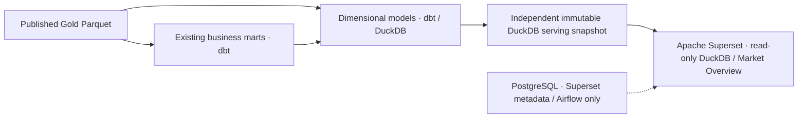

# HCMC F&B Data Platform

A Khánh Hội pilot integrating Overture and Google data into a traceable F&B catalog. M5 serves existing published Gold through a dimensional warehouse and Apache Superset; it does not rerun collection, identity matching or Gold integration.

## Architecture



Upstream flow: Overture + Google → Bronze → Silver → canonical ER → optional Human Review → Gold. Upstream integration changes are outside this M5 setup.

SQL/dbt owns dimensions, facts, marts and shared BI views. dbt builds/tests a working DuckDB database; publication copies it to an immutable serving filename after hash, grain and reconciliation checks. Superset opens the snapshot read-only. Refresh updates its URI explicitly; existing readers can finish on the retained old file. Parquet Bronze/Silver/Gold and their manifests remain unchanged. There is no DuckDB server/port, chart framework, Redis or Celery.

**Verified:** isolated Demo and Real deployments passed Docker startup, dbt, 20 native charts/3 tabs, street-map tiles, reads during/after two refreshes, dbt Docs and three Airflow DAG imports/serialization. PostgreSQL analytics transport has been retired; existing historical databases/volumes remain untouched.

## Tech stack

Python 3.12, Parquet/PyArrow, canonical ER, dbt-core 1.11.17, dbt-duckdb 1.11.1, DuckDB 1.5.5, duckdb-engine 0.17.0, Superset 6.0.0, Airflow 2.10.5 and PostgreSQL 15 for service metadata/state. Dockerfiles pin dependency versions; no live crawling is part of verification.

## Business questions and models

- How many canonical records are observed, by area, category and source association?
- Where are they located, and what are their ratios against sourced area/population references?
- How many logical reviews exist, which have accepted store associations, and how do their ratings/dates vary?

[Dimensional modeling](docs/DIMENSIONAL_MODELING.md) defines the processes and grains. [BRD v1.5](docs/01_BRD.md) keeps data quality separate from business facts.

| Object | Grain |
|---|---|
| `dim_store`, `dim_category`, `dim_area`, `dim_date` | One current store, analytical category, sourced area, or day |
| `fact_store_snapshot` | One canonical store × Gold release |
| `fact_review` | One unique logical review, including unmatched reviews |
| `bridge_store_source` | One accepted source mapping × Gold release |

Seven models live only in `pipelines/dimensional_analytics`; three distinct marts remain in `pipelines/business_analytics`. DuckDB stores these tables and the shared `bi` views. No dimensions/facts are added for ER/DQ reporting. Failed builds preserve the old snapshot. Logical reviews without an accepted canonical association keep their Google identity and NULL canonical key.

## Verified pilot results

Gold release: `5d7915f7313e0da6dc10f1bb`.

| Metric | Observed result |
|---|---:|
| Overture-anchored canonical records | 725 |
| Accepted Google links / source-only records | 302 / 423 |
| Accepted source mappings / unresolved candidate pairs | 1,027 / 174 |
| Logical reviews | 10,139 |
| Attached / unmatched reviews | 6,942 / 3,197 |
| Gold category provisional / pending | 267 / 458 |

These are catalog records, not a census. Accepted links are machine decisions, not independently human-verified ground truth. Google aggregate Place ratings and collected individual review ratings remain separate metrics.

## Setup

### Prerequisites

- Docker Desktop with Linux containers; PowerShell 7.2+ on Windows (verified host) for the resumable runner. Full Airflow/browser image builds need more RAM/time than the BI-only demo.
- For browser verification: Python 3.11+ with `playwright==1.42.0` and installed Google Chrome at the verifier's default path, or run the verifier separately with `--chrome`.
- Demo uses invented, non-PII sources generated from code. Real mode requires authorized Gold, Places/Reviews provenance, business marts and demographic releases; these are **not shipped in Git**.

`compose.analytics.yaml` defines DuckDB/dbt, Superset, dbt Docs and metadata-only PostgreSQL. `compose.yaml` defines pipeline/Airflow/browser runtimes. The runner uses separate project names, secrets, outputs and ports. Existing volumes and credentials are never reset.

### Configure and start

```powershell
# Copy only when .env is absent; edit local ports if needed.
if (-not (Test-Path .env)) { Copy-Item .env.example .env }
python -m pip install playwright==1.42.0
# All builds/startup/verification below run manually and preserve checkpoints/logs.
pwsh -File .\scripts\Invoke-DuckDbPilot.ps1 -Mode Demo -RunName demo-01
```

`.env.example` contains ports, never credentials. The new runner generates isolated secrets under `.local/duckdb-final/<run>/secrets`, never overwrites existing files and mounts them as Docker secrets. Only the Superset metadata database is provisioned; no PostgreSQL analytics tables or loader are used. Existing historical databases remain intact.

The analytics Dockerfile supplies a warehouse target and `superset-duckdb`, with pinned DuckDB/duckdb-engine and a PostgreSQL driver for Superset metadata. No additional Dockerfile is needed. Demo data has 2 invented stores/4 reviews and visibly marks all catalog/review/reference metrics SYNTHETIC. It does not ship Google identities, review text or fake human decisions. Demo counts must never be presented as pilot KPIs.

### Real releases and full pipeline mode

Restore authorized publications into `fnb-platform_demo_outputs`, preserving their recorded `/demo/...` paths. Business marts mount from `.local/m3/dashboard` at `/business-input`; the demographic reference mounts from `output/area-demographics-silver-v1` at `/area-input`. Keep manifests, upstream Places/Reviews manifests and pinned artifacts together. Runner defaults describe the verified local pilot; pass its named release/hash parameters for another compatible snapshot. Missing or mismatched inputs are rejected, never synthesized.

```powershell
pwsh -File .\scripts\Invoke-DuckDbPilot.ps1 -Mode Both -RunName final-01 -WithRuntime
```

This manual command verifies Demo and Real in separate projects, builds images, checks real pinned admission, runs dbt/tests, publishes DuckDB snapshots, imports the same 20-chart/3-tab bundle and checks the dashboard during/after a second refresh. `-WithRuntime` also builds isolated pipeline/browser/Airflow images, runs synthetic browser checks, starts Airflow and verifies three DAGs import/serialize. It never runs a live crawler or rebuilds Gold. Logs/checkpoints/results stay under `.local/duckdb-final/<run>`. Same command resumes; changed source/options require another run name.

Full ingestion is separate: provide licensed source snapshots, scope/crawl limits and explicit release pins in `config/airflow/*.example.json`, and set `FNB_INPUT_ROOT` before creating the runtime. Replay entrypoint, after replacing the example with a real admitted config:

```powershell
pwsh -File .\scripts\Invoke-FnbDag.ps1 -ProjectName fnb-duckdb-final-01-runtime -DagId fnb_integration_gold -ConfigFile .local/pinned-integration.json
```

Ingestion DAGs are `fnb_overture_ingestion` and `fnb_google_crawl`; integration consumes their explicit published handoffs. Existing CLI scripts/runners support checkpoints/replay. Live Google crawling may require login/session and permission; default live-crawl/download flags remain disabled. Do not assume a clean clone grants source access or automatically supplies cookies.

This package verifies offline replay, runtime/browser smoke and analytics, not live ingestion. The seven pending crawler/smoke changes are deliberately excluded: the Airflow live-crawl acceptance helper and PostgreSQL incremental-window integration still require that separately reviewed change set. Their dependent tests remain local rather than being packaged against an incompatible crawler API. Use the public Demo or authorized published inputs for the reproducible workflow below.

### Developer URLs and dbt lineage

Verified local endpoints: Superset **http://127.0.0.1:18089/superset/dashboard/hcmc-fnb-market-overview/**; dbt Docs **http://127.0.0.1:18081/**; Airflow with `-WithRuntime` **http://127.0.0.1:18082/**. Superset user is `portfolio_admin`; Airflow user is `demo`. Password files stay in the isolated run's secret directory. These are localhost services.

Switch docs from repository root:

```powershell
pwsh -File .\scripts\Invoke-DuckDbPilot.ps1 -RunName final-01 -Docs business_analytics
```

Valid projects: `dimensional_analytics`, `business_analytics`, `gold_staging`, `area_enrichment`; they remain separate. Profiles and `FNB_WAREHOUSE_DUCKDB`/`FNB_DBT_DATABASE` are selected automatically. Docs catalog generation uses a copy of the build DB, never a writable serving snapshot. Gold/Area docs require those projects' actual build artifacts; Area discovers the checksum-pinned publication under `output/area-enrichment-staging-v1` read-only; `FNB_AREA_DBT_RELEASE` may explicitly select another mounted release. No DuckDB path/profile edits are needed. Missing artifacts produce an explicit error; no synthetic lineage substitutes for a real build.

### Verify and stop

```powershell
# Read .local/duckdb-final/final-01/verification.json; require actual PASS.
# Rerun the identical command to resume/verify; choose a new name if source changed.
pwsh -File .\scripts\Invoke-DuckDbPilot.ps1 -Mode Both -RunName final-01 -WithRuntime
# Stop only the isolated BI project; never delete volumes.
docker compose --project-name fnb-duckdb-final-01 -f compose.analytics.yaml stop superset dbt-docs postgres
```

Tests use synthetic fixtures and owned temporary schemas. Install the project's test/dbt dependencies to run analytics tests explicitly; the small default pytest selection is not M5 coverage. Snapshot tests cover rejected corruption, unique grains, retained unmatched reviews, read-only access, failed-refresh rollback and concurrent processes.

**Evidence:** isolated `final-02-demo` and `final-02` runs passed. Real KPIs are 725 stores, 302 accepted-linked, 423 source-only and 10,139 logical reviews (6,942 attached / 3,197 unmatched). The 7 dimensional models passed 41 dbt tests; the Demo also built the 3 business marts with 8 tests. Airflow UI/import/serialization verification is separate from a scheduled business DagRun. Local evidence is ignored by Git; logs and databases are never distributed.

Observed Real serving samples: Superset 251.6 MiB; metadata PostgreSQL 123 MiB; query-probe process peak 81.03 MiB. Five fresh-connection DuckDB samples per query were about 45–85 ms. Container samples are not isolated peaks; the probe includes connection open/close.

PostgreSQL analytics loader, its old runner/tests, unused credentials and migration overlay are removed. Post-cleanup regression checks verify the retained native BI bundle and shared SQL. Reproducing Real requires authorized publications; Demo uses no private inputs. Linux-host execution and live crawling are not claimed verified.

## Data limitations

Only the supported Khánh Hội boundary has catalog coverage. Provider area/population references retain source, year, basis and WARNING status; they are not independently verified census figures. Unknown categories/dates remain unknown. Unmatched reviews stay separate; observed review activity is not venue-opening growth. No source review text, reviewer identities, credentials, raw captures or real datasets are distributed. Source redistribution rights are separate from the code license. Sentiment, recommendation and market-wide coverage claims are outside this MVP.
