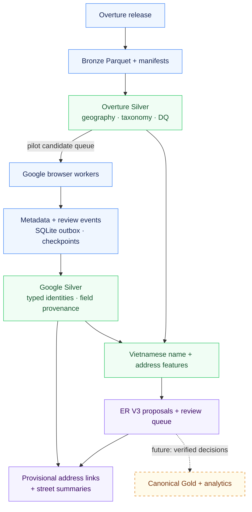

<div align="center">

# HCMC F&B Location Data Integration Pipeline

### Fragmented listings → traceable location data

Multi-source acquisition · Vietnamese address standardization · Explainable entity resolution


[Results](#results-at-a-glance) · [Architecture](#architecture) · [Engineering](#engineering-highlights) · [Quick start](#quick-start) · [Evidence](docs/PORTFOLIO_AUDIT.md)

</div>

F&B providers describe the same venue differently: names vary, addresses are incomplete, branches share brand names, and listings become stale. This project turns those records into source-linked datasets and explainable match proposals for **market research, competitor analysis and location screening**.

**Implemented:** local acquisition, Silver processing, incremental change detection and experimental ER V3. **Next:** independently verified business identities and a canonical analytics catalog.

## Results at a glance

| **77,966** | **725** | **452** | **476** |
|:---:|:---:|:---:|:---:|
| F&B source records | Pilot F&B candidates | Google metadata snapshots | Cross-source candidate links |
| HCMC-area Overture bbox | Khánh Hội, provisional | 426 identities with metadata | All remain `ER_PENDING` |
| [Baseline evidence](docs/PORTFOLIO_AUDIT.md#hcmc-area-baseline-verification) | [Pilot schema](docs/CURRENT_DATA_SCHEMA.md) | [Google Silver](docs/GOOGLE_SILVER_M1.md) | [ER V3](docs/M2_ER_V3_EXPERIMENTAL.md) |

> **Regional baseline ≠ completed city-wide integration.** The 77,966 records come from a September 2026 Overture bbox extract, not a city-polygon census or a 77K-place Google crawl. The October Khánh Hội pilot uses a separate release and scope. Match proposals are not verified businesses or measured matching accuracy.

## Architecture

The pipeline separates acquisition, source-specific standardization and identity decisions. Current execution uses local CLI/experiment modules.



Foody is a separate acquisition/profiling experiment, outside current Overture–Google ER. The stored OSM ward polygon supplies geographic context. Review events are persisted alongside metadata; they are not inputs to ER V3.

## Engineering highlights

| Challenge | Implementation | Why it matters |
|---|---|---|
| **Reproduce a source snapshot** | Explicit Overture release, fresh Bronze directory, Parquet read-back verification and SHA-256 metadata | Makes inputs inspectable and protects prior snapshots |
| **Standardize inconsistent records** | Preserve raw values, typed Google IDs, normalized names/addresses and field-level provenance | Every retained or fallback field can be traced to an observation |
| **Avoid wrong-branch matches** | Combine name, distance, house/street/range evidence and branch warnings; keep ambiguous cases for review | Similar names and nearby coordinates cannot establish identity alone |
| **Bound spatial comparison work** | Shapely STRtree candidate blocking followed by haversine distance | Produces 3,442 pairs within 50 m from 725 candidates without an all-pairs distance matrix |
| **Process source changes safely** | New/updated/unchanged/missing states; review ID/content hashes and bounded known-record streaks | Supports repeated updates while preserving uncertainty about closures/deletions |
| **Recover interrupted collection** | SQLite pending-event outbox, deterministic Parquet batch files, checkpoints and retained metadata | Supports replay and inspection when browser or review extraction fails |

**A concrete identity problem:** two ABC Bakery source records can select one Google branch. The [ER analysis](docs/M2_ER_V2.md) distinguishes a same-address proposal from a pair 320 m apart with different house/street values, while preserving the shared-ID flag.

**Crawler recovery** includes bounded discovery, Vietnamese/English review controls, stale-element reacquisition, review-pane validation and newest-sort confirmation. Metadata can survive a later review failure. [Recovery implementation report →](docs/GOOGLE_CRAWLER_RECOVERY.md)

## Measured outputs

| Workload | Saved result | Interpretation |
|---|---|---|
| **ER V3** | **346** match proposals · **6** non-match proposals · **90** review · **34** insufficient-data | Same 476 relationships; no representative labeled precision/recall benchmark |
| **Google Silver** | **460** typed identity rows: 426 with metadata + 34 missing-metadata placeholders | 251 Overture IDs have no valid selected/opened link in the staged inventory |
| **Incremental comparison** | **546** new · **2,665** updated · **2,988** unchanged · **24** missing-from-release | Comparable buffered Khánh Hội extracts; missing does not mean closed |
| **Address enrichment** | **346** provisional Overture attachments; **46** normalized street names | Observed labels and proposed links, not verified addresses or complete street coverage |
| **Fixture validation** | **604 passed** across 28 selected offline modules before GitHub publication | Tests implementation behavior, not live-source completeness or real-world identity |

Evidence: [incremental manifest analysis](docs/PORTFOLIO_AUDIT.md#incremental-results) · [address enrichment](docs/GOOGLE_ADDRESS_ENRICHMENT_V1.md) · [spatial method](experiments/overture_gold_contract/SPATIAL_PREDEDUP.md) · [test scope and checks](docs/PORTFOLIO_AUDIT.md#validation-performed).

### Data products available locally

- **Source and quality tables:** Bronze snapshots, source catalogs, release change sets, eligibility/DQ reports and spatial candidate pairs.
- **Integration evidence:** Google current identities, candidate source mappings, comparison features, ER proposals and review queues.
- **Research outputs:** review change events, provisional address links, a street dictionary and street summaries.

Offline publishers validate versioned artifacts before replacing `current.json`. SQLite and Parquet do not share one transaction; outbox replay provides recoverable delivery. Review uniqueness is enforced within each job database, not across the entire lake.

## Sources and tech stack

| Component | Role and current status |
|---|---|
| **Overture Maps** | Regional snapshot baseline, ward filtering, Silver/eligibility and release comparison; 77,966 F&B rows within bbox `[106.55, 10.60, 106.90, 10.95]`, release `2026-09-23.1` |
| **Google Maps** | SeleniumBase/Chrome acquisition, metadata/review persistence, Silver and recovery; coverage incomplete and collection/reuse rights unresolved |
| **Foody** | HTTPX/Beautiful Soup/Playwright acquisition experiments; 557-record ward-clipped profile. [Source-selection decision remains inconclusive](experiments/source_evaluation/results/20261101-khanh-hoi-v3/04_source_selection_decision.md) |
| **OpenStreetMap** | Stored ward boundary, tested JSON-element adapter and separate road-reference study; OSM POIs are outside current ER |
| **Python · PyArrow · NumPy · Shapely** | Core transformations, Parquet schemas, taxonomy/spatial filtering and comparison features |
| **DuckDB · SQLite** | [DuckDB SQL validation](experiments/overture_silver/consumer.py) of staged Overture Silver; SQLite dispatch/review state and outbox |
| **pytest · GitHub Actions** | Fixture/regression tests; Windows CI covers the core baseline and selected experiments |

**Planned:** Apache Airflow orchestration, verified canonical Gold and recommendations. Airflow currently has a [proposed DAG design](docs/12_ORCHESTRATION_OPERATIONS.md), with no executable DAG or production scheduling evidence.

## Project structure

```text
src/fnb_platform/       Catalog, normalization, incremental comparison, Silver, ER
crawl_experiment/      Google acquisition, persistence, checkpoints and recovery
scripts/               Worker runners and offline CLI wrappers
experiments/           Overture publication, source profiling, browser studies
config/admin_areas/    Khánh Hội polygon and source provenance
tests/                 Catalog, crawler, processing and regression fixtures
docs/                  Implementation reports, design targets and evidence ledger
requirements/          Pinned offline baseline dependencies
```

## Quick start

From the repository root, use a chosen CPython environment. The measured local baseline is **Windows / CPython 3.12.7**.

```powershell
python -m pip install -e ".[test]"
python -B scripts/run_offline_tests.py
```

The socket-blocked baseline selects four core test modules. To exercise Silver, comparison features, ER V3 and enrichment:

```powershell
python -B -m pytest tests/test_google_silver.py tests/test_comparison_features.py tests/test_entity_resolution_v3.py tests/test_google_address_enrichment.py -q
```

<details>
<summary><strong>Inspect processing commands without starting a crawl</strong></summary>

```powershell
python -B scripts/google_silver.py --help
python -B scripts/comparison_features.py --help
python -B scripts/entity_resolution.py --help
python -B scripts/google_address_enrichment.py --help
```

Stage reruns need pinned source inputs and preceding publications: [Google Silver instructions](docs/GOOGLE_SILVER_M1.md) · [ER V3 instructions](docs/M2_ER_V3_EXPERIMENTAL.md).

</details>

Runtime `data/` and `output/` are ignored by Git, and some inputs remain in a sibling historical worktree. A clone alone cannot reproduce the saved real-data results. The core package does not declare the entire browser/experiment stack; a clean end-to-end installation remains unverified.

## Roadmap and boundaries

1. **Validate identity:** independently label branch-sensitive decisions, measure held-out precision/recall and candidate recall, then publish reviewed canonical IDs.
2. **Make the pilot portable:** package complete dependencies, parameterize historical paths and supply sanitized fixtures with pinned manifests.
3. **Expand with evidence:** introduce versioned geographic scopes and benchmark representative density, memory/disk use and recovery before HCMC-wide collection. [Expansion notes →](docs/TPHCM_CRAWL_EXPANSION_NOTES.md)

Current matching rules are ward-scoped. Full-city coverage, scalability, deployed consumers and commercial impact have not been validated. Provider permissions and review-data retention must be resolved before expanding or sharing derived products.

<details>
<summary><strong>Data rights and privacy</strong></summary>

The [MIT license](LICENSE) covers software. Provider data retains separate [Overture attribution](https://docs.overturemaps.org/attribution/), [OSM/ODbL obligations](https://www.openstreetmap.org/copyright) and [Google Maps restrictions](https://www.google.com/intl/en/help/terms_maps/). Browser access does not establish permission to collect, retain or republish content. Keep raw reviews, cookies and browser sessions private.

</details>
