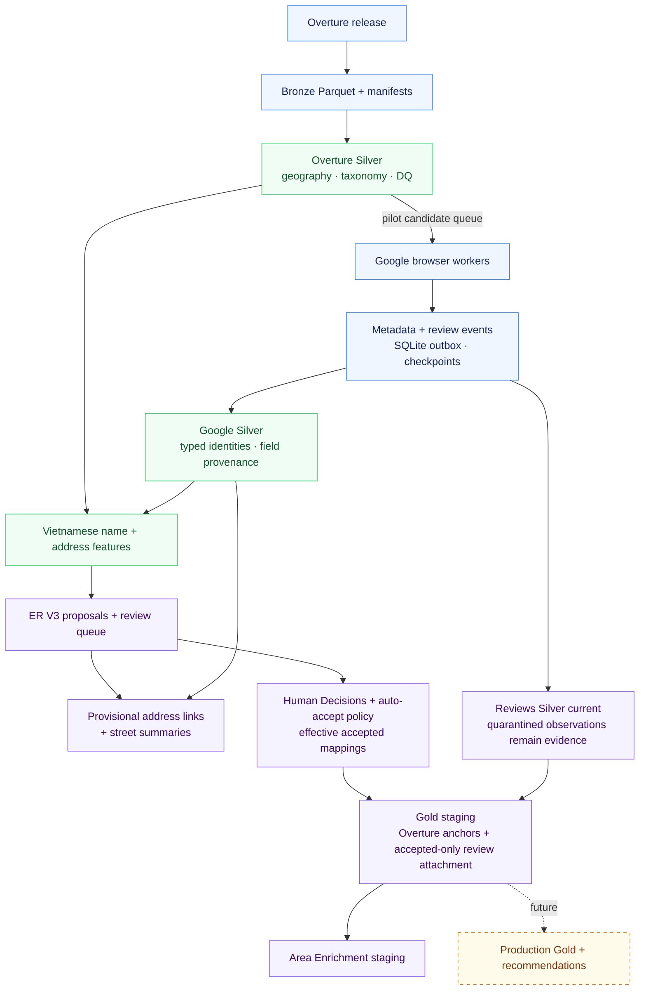

<div align="center">

# HCMC F&B Location Data Integration Pipeline

### Fragmented listings → traceable location data

Multi-source acquisition · Vietnamese address standardization · Explainable entity resolution


[Results](#results-at-a-glance) · [Architecture](#architecture) · [Engineering](#engineering-highlights) · [Quick start](#quick-start) · [Evidence](docs/PORTFOLIO_AUDIT.md)

</div>

F&B providers describe the same venue differently: names vary, addresses are incomplete, branches share brand names, and listings become stale. This project turns those records into source-linked datasets and explainable match proposals for **market research, competitor analysis and location screening**.

**Implemented:** local acquisition, Overture/Google Places/Google Reviews Silver, incremental comparison, ER V3, Human Decisions, effective mapping activation, Gold staging with review attachment, and Area Enrichment. Gold staging and the Human Decisions flow have saved runtime verification. **Next:** independent business-identity verification and production Gold/recommendation readiness.

## Results at a glance

| **77,966** | **725** | **452** | **476** |
|:---:|:---:|:---:|:---:|
| F&B source records | Pilot F&B candidates | Google metadata snapshots | Cross-source candidate links |
| HCMC-area Overture bbox | Khánh Hội, provisional | 426 identities with metadata | ER proposals; effective decisions are a separate stage |
| [Baseline evidence](docs/PORTFOLIO_AUDIT.md#hcmc-area-baseline-verification) | [Pilot schema](docs/CURRENT_DATA_SCHEMA.md) | [Google Silver](docs/GOOGLE_SILVER_M1.md) | [ER V3](docs/M2_ER_V3_EXPERIMENTAL.md) |

> **Regional baseline ≠ completed city-wide integration.** The 77,966 records come from a September 2026 Overture bbox extract, not a city-polygon census or a 77K-place Google crawl. The October Khánh Hội pilot uses a separate release and scope. Match proposals are not verified businesses or measured matching accuracy.

## Architecture

The pipeline separates acquisition, source-specific standardization and identity decisions. Current execution uses local CLI/experiment modules.



Foody is a separate acquisition/profiling experiment, outside current Overture–Google ER. The stored OSM ward polygon supplies geographic context. Review events are persisted alongside metadata; they are not inputs to ER V3.

Gold staging consumes authoritative Reviews Silver **current**, joins typed Google identities through effective accepted mappings, and publishes `review_attachment` and `unmatched_review_accounting` alongside the catalog tables. Python and dbt gates enforce exact Overture anchors, accepted-only attachment, uniqueness, foreign keys, no fanout and review conservation. Catalog-only staging remains supported. This is **staging**, not deployed production Gold; an Overture anchor is not proof of one independently verified physical business.

## Engineering highlights

| Challenge | Implementation | Why it matters |
|---|---|---|
| **Reproduce a source snapshot** | Explicit Overture release, fresh Bronze directory, Parquet read-back verification and SHA-256 metadata | Makes inputs inspectable and protects prior snapshots |
| **Standardize inconsistent records** | Preserve raw values, typed Google IDs, normalized names/addresses and field-level provenance | Every retained or fallback field can be traced to an observation |
| **Avoid wrong-branch matches** | Combine name, distance, house/street/range evidence and branch warnings; keep ambiguous cases for review | Similar names and nearby coordinates cannot establish identity alone |
| **Bound spatial comparison work** | Shapely STRtree candidate blocking followed by haversine distance | Produces 3,442 pairs within 50 m from 725 candidates without an all-pairs distance matrix |
| **Process source changes safely** | New/updated/unchanged/missing states; review ID/content hashes and bounded known-record streaks | Supports repeated updates while preserving uncertainty about closures/deletions |
| **Recover interrupted collection** | SQLite pending-event outbox, deterministic Parquet batch files, checkpoints and retained metadata | Supports replay and inspection when browser or review extraction fails |

**A concrete identity problem:** two ABC Bakery source records can select one Google branch. The [ER analysis](docs/M2_ER_V2.md) distinguishes a same-address proposal from a pair 320 m apart with different house/street values, while preserving the shared-ID flag.

**Crawler recovery** includes bounded discovery, Vietnamese/English review controls, stale-element reacquisition, review-pane validation and newest-sort confirmation. Metadata can survive a later review failure. [Recovery implementation report →](docs/GOOGLE_CRAWLER_RECOVERY.md)

## Measured outputs

| Workload | Saved result | Interpretation |
|---|---|---|
| **ER V3** | **346** match proposals · **6** non-match proposals · **90** review · **34** insufficient-data | Same 476 relationships; no representative labeled precision/recall benchmark |
| **Google Silver** | **460** typed identity rows: 426 with metadata + 34 missing-metadata placeholders | 251 Overture IDs have no valid selected/opened link in the staged inventory |
| **Incremental comparison** | **546** new · **2,665** updated · **2,988** unchanged · **24** missing-from-release | Comparable buffered Khánh Hội extracts; missing does not mean closed |
| **Address enrichment** | **346** provisional Overture attachments; **46** normalized street names | Observed labels and proposed links, not verified addresses or complete street coverage |
| **Fixture validation** | **604 passed** across 28 selected offline modules before GitHub publication | Tests implementation behavior, not live-source completeness or real-world identity |
| **Gold review-enabled runtime verification** | **725** anchors, **304** accepted mappings, **6,980 attached + 3,159 unmatched = 10,139 current reviews**; 6 dbt models and 26 tests passed | Saved Khánh Hội runtime snapshot; immutable reuse/checksums verified, not a production deployment |
| **Human Decisions E2E simulation** | Registered queue, 3 simulated decisions (`MATCH`, `NON_MATCH`, `UNSURE`); **7,030 attached + 3,109 unmatched = 10,139**; 6 dbt models and 26 tests passed | `TEST_AI_REVIEWER` / `AI_SIMULATED_TEST`; HUMAN-path precedence, stale-evidence rejection and deterministic reuse tested. **No real human verification** |

Evidence: [incremental manifest analysis](docs/PORTFOLIO_AUDIT.md#incremental-results) · [address enrichment](docs/GOOGLE_ADDRESS_ENRICHMENT_V1.md) · [spatial method](experiments/overture_gold_contract/SPATIAL_PREDEDUP.md) · [test scope and checks](docs/PORTFOLIO_AUDIT.md#validation-performed).

The two runtime results above are saved verification runs from **2026-11-14 UTC**, not current counts recomputed on every checkout. Local-only reports: [Gold runtime](../.codex-scratch/gold-runtime-01-mdy3lknm/verification.json) and [Human flow simulation](../.codex-scratch/human-flow-test-02/verification.json). These scratch artifacts and runtime inputs are not distributed with a clone. The simulation used three registered queue records, not the separate 48-record AUTO_ACCEPTED validation sample, which the importer does not currently admit. A mechanically emitted `HUMAN_VERIFIED_LINK` in the simulation does not establish real human verification or measured match precision.

### Data products available locally

- **Source and quality tables:** Bronze snapshots, source catalogs, release change sets, eligibility/DQ reports and spatial candidate pairs.
- **Integration evidence:** Google current identities, candidate source mappings, comparison features, ER proposals and review queues.
- **Research outputs:** review change events, provisional address links, a street dictionary and street summaries.
- **Gold staging:** `dim_store`, `store_source_mapping`, `source_accounting`, `link_accounting`; review-enabled releases add `review_attachment` and `unmatched_review_accounting`. Area Enrichment has a separate staging/dbt project.

Offline publishers validate versioned artifacts before replacing `current.json`. SQLite and Parquet do not share one transaction; outbox replay provides recoverable delivery. Review uniqueness is enforced within each job database, not across the entire lake.

## Sources and tech stack

| Component | Role and current status |
|---|---|
| **Overture Maps** | Regional snapshot baseline, ward filtering, Silver/eligibility and release comparison; 77,966 F&B rows within bbox `[106.55, 10.60, 106.90, 10.95]`, release `2026-09-23.1` |
| **Google Maps** | SeleniumBase/Chrome acquisition, metadata/review persistence, Silver and recovery; coverage incomplete and collection/reuse rights unresolved |
| **Foody** | HTTPX/Beautiful Soup/Playwright acquisition experiments; 557-record ward-clipped profile. [Source-selection decision remains inconclusive](experiments/source_evaluation/results/20261101-khanh-hoi-v3/04_source_selection_decision.md) |
| **OpenStreetMap** | Stored ward boundary, tested JSON-element adapter and separate road-reference study; OSM POIs are outside current ER |
| **Python · PyArrow · NumPy · Shapely** | Core transformations, Parquet schemas, taxonomy/spatial filtering and comparison features |
| **DuckDB · dbt · SQLite** | Overture SQL validation, Gold/Area dbt staging and DQ gates; SQLite dispatch/review state and outbox |
| **pytest · GitHub Actions** | Explicit offline contract and pinned dbt integration profiles on Windows; manual runtime E2E is excluded from CI |

**Planned:** Apache Airflow orchestration, production Gold, independently verified physical-store identities and recommendations. Airflow currently has a [proposed DAG design](docs/12_ORCHESTRATION_OPERATIONS.md), with no executable DAG or production scheduling evidence.

## Project structure

```text
src/fnb_platform/       overture/, google/, integration/, gold/, reference/ domains
crawl_experiment/      Google acquisition, persistence, checkpoints and recovery
scripts/               Worker runners and offline CLI wrappers
pipelines/             Gold staging and Area Enrichment dbt models/tests
experiments/           Overture publication, source profiling, browser studies
config/admin_areas/    Khánh Hội polygon and source provenance
tests/                 Catalog, crawler, processing and regression fixtures
docs/                  Implementation reports, design targets and evidence ledger
requirements/          Pinned offline baseline dependencies
```

Canonical modules, compatible CLI paths and debugging steps: [module layout guide](docs/MODULE_LAYOUT.md).

## Quick start

From the repository root, use **CPython 3.12** (the measured local baseline is Windows / 3.12.7). Create a separate environment when needed; the package's `test` extra pins the fixture dependencies. No browser binaries, live source access or runtime releases are needed for these fixture profiles.

```powershell
py -3.12 -m venv .venv
& .venv/Scripts/python.exe -m pip install -e ".[test]"
& .venv/Scripts/python.exe -B scripts/run_offline_tests.py --profile offline
```

### Test execution profiles

| Profile | Explicit scope | Dependencies / inputs | CI / local execution |
|---|---|---|---|
| `offline` (default) | Core catalog/OSM; Overture snapshot, eligibility and spatial contracts; Google Places/Reviews Silver and reliability; comparison, ER V1/V2/V3; category, review export, Human Decisions/Auto-Accept; Gold admission/publication/direct-SQL contracts; Area assignment/freshness; address/ranking/input regressions | `.[test]`; synthetic fixtures generated under a new temporary results directory | Default fixture job. No browser/crawler or live ingestion. Tests with direct **or fixture-mediated** dbt execution are explicitly deselected |
| `dbt-integration` | Real Gold catalog/review builds, empty inputs, exact-anchor/corruption tests, review conservation, publication guards, category policy and Area dbt build | `.[test,dbt]`; exact dbt adapter pins and repository dbt projects; generated fixtures, not historical runtime datasets | Separate fixture job. Local multi-minute runs are launched manually |
| `manual-runtime` | Existing compatible Silver/ER/category/human releases through staging in a fresh scratch output root | Exact manifests/lineage, pinned dbt environment, saved inputs and a reviewed scratch runner | Never default CI. This runner only describes the profile; it does not execute a runtime pipeline |

The authoritative selectors and dbt exclusions live in [the runner](scripts/run_offline_tests.py). It no longer discovers experiment directories automatically. External socket access is blocked in the pytest process; loopback IPC is allowed. This is not an OS sandbox for subprocesses; real dbt uses the local DuckDB adapter, with telemetry disabled. Missing dependencies/registered suites, mismatched dbt pins, empty selection, or skipped/xfail tests do not produce a successful profile result. Fixture errors fail normally; no runtime dataset is silently substituted. Bare `pytest` retains only the legacy four-suite smoke selection; use the profiles for contract coverage.

Install the dbt profile and inspect or run its selection:

```powershell
& .venv/Scripts/python.exe -m pip install -e ".[test,dbt]"
& .venv/Scripts/python.exe -B scripts/run_offline_tests.py --profile offline --list
& .venv/Scripts/python.exe -B scripts/run_offline_tests.py --profile dbt-integration --list
& .venv/Scripts/python.exe -B scripts/run_offline_tests.py --profile offline --suite tests/test_google_reviews_silver.py
& .venv/Scripts/python.exe -B scripts/run_offline_tests.py --profile dbt-integration --collect-only
& .venv/Scripts/python.exe -B scripts/run_offline_tests.py --profile dbt-integration
```

dbt pins match [requirements/gold-staging.txt](requirements/gold-staging.txt): `dbt-core==1.11.17`, `dbt-duckdb==1.11.1`, `duckdb==1.5.5`. The existing R06 runtime environment has these pins but inherits `pytest==7.4.4`; a new install uses the project's declared `pytest==9.1.1`. The runner disables legacy nose compatibility so pytest 7 does not treat ordinary `setup` helpers as module hooks. Do not treat the older environment's saved results as proof of a clean install with every declared test pin.

The runner prints a unique results directory with `pytest.log`, `progress.jsonl`, `summary.json` and JUnit XML. Use `--results-dir <scratch-parent>` to choose its parent; existing evidence is not reused or overwritten. `--collect-only` reports `COLLECTED`, not test PASS. For multi-minute local runs, prepare the command and launch it manually per AGENTS.md, then inspect the saved summary when finished. GitHub Actions runs both fixture profiles and uploads diagnostics; configuration alone is not evidence of a green CI run.

### Manual runtime E2E

Runtime staging requires compatible published releases; a clone alone is insufficient. Review the input admission/lineage first and use a **new scratch output root**, never the historical/catalog-only root. Runtime E2E and simulated decisions are not part of either fixture profile. For example, after confirming the inputs:

```powershell
python -B scripts/gold_staging.py build --active-root <effective-mapping-root> --category-root <category-root> --reviews-root <reviews-silver-root> --output-root <new-scratch-gold-root>
python -B scripts/run_offline_tests.py --profile manual-runtime --list
```

Use the pinned environment's Python for that command. A human-flow test must generate annotations against the registered queue from `er_category_review_export`, use `import_human_decisions.py` with a scratch ledger, then `er_auto_accept_shadow.py` and `gold_staging.py activate/build` with separate scratch roots. Keep `AI_SIMULATED_TEST` in reviewer notes and `TEST_AI_REVIEWER` as reviewer; do not import the 48-record validation workbook or claim independent human verification. Preserve logs/checkpoints and verify unchanged input hashes, accepted-only attachment, conservation and same-input reuse in the scratch runner.

<details>
<summary><strong>Inspect processing commands without starting a crawl</strong></summary>

```powershell
python -B scripts/google_silver.py --help
python -B scripts/comparison_features.py --help
python -B scripts/entity_resolution.py --help
python -B scripts/google_address_enrichment.py --help
python -B scripts/import_human_decisions.py --help
python -B scripts/er_auto_accept_shadow.py --help
python -B scripts/gold_staging.py --help
```

Stage reruns need pinned source inputs and preceding publications: [Google Silver instructions](docs/GOOGLE_SILVER_M1.md) · [ER V3 instructions](docs/M2_ER_V3_EXPERIMENTAL.md).

</details>

Runtime `data/` and `output/` are ignored by Git, and some inputs remain in a sibling historical worktree. A clone alone cannot reproduce the saved real-data results. These installation commands cover fixture contracts and local dbt, not the entire live browser/experiment stack; a clean live end-to-end installation remains unverified.

## Roadmap and boundaries

1. **Validate identity:** independently label branch-sensitive decisions, measure held-out precision/recall and candidate recall, then publish reviewed canonical IDs.
2. **Make the pilot portable:** package complete dependencies, parameterize historical paths and supply sanitized fixtures with pinned manifests.
3. **Expand with evidence:** introduce versioned geographic scopes and benchmark representative density, memory/disk use and recovery before HCMC-wide collection. [Expansion notes →](docs/TPHCM_CRAWL_EXPANSION_NOTES.md)

Current matching rules are ward-scoped. Full-city coverage, scalability, deployed consumers and commercial impact have not been validated. Provider permissions and review-data retention must be resolved before expanding or sharing derived products.

<details>
<summary><strong>Data rights and privacy</strong></summary>

The [MIT license](LICENSE) covers software. Provider data retains separate [Overture attribution](https://docs.overturemaps.org/attribution/), [OSM/ODbL obligations](https://www.openstreetmap.org/copyright) and [Google Maps restrictions](https://www.google.com/intl/en/help/terms_maps/). Browser access does not establish permission to collect, retain or republish content. Keep raw reviews, cookies and browser sessions private.

</details>
