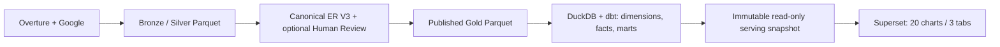

# HCMC F&B Data Platform

Integrate Overture and Google observations into a reproducible F&B catalog for the Khánh Hội pilot. The project preserves source provenance, separates uncertain identities and reconciles reviews before exposing business analytics. Canonical records describe observed data; they are not a census or independently verified ground truth.



PostgreSQL serves Superset metadata and the separate Airflow/crawler state databases. DuckDB is the analytics warehouse. Bronze/Silver/Gold remain Parquet releases with manifests and SHA256. SQL owns KPI definitions; Superset reads the shared DuckDB views.

## Prerequisites

- Git, PowerShell **7.2+** (`pwsh`), Docker Desktop with Linux containers and Docker Compose v2.
- Internet for pinned image/dependency downloads and street-map tiles.
- No Python, conda, dbt or Chrome installation is required on the host for BI setup. All jobs and browser checks run in Docker.
- Windows is the development host. Linux-host setup is **NOT_VERIFIED**.

## Quick Start — public synthetic Demo

From the repository root:

```powershell
pwsh -File .\scripts\Invoke-DuckDbPilot.ps1
```

The runner creates `.env` from [.env.example](.env.example) only if absent, validates Docker and available ports, builds the required images, generates missing secrets, builds/tests DuckDB, initializes Superset metadata and imports the data-free native dashboard bundle. Logs, checkpoints and generated data stay in `.local/duckdb-final/mentor-demo/`. Rerun the identical command to recover/resume. Changed source/configuration requires a new `-RunName`; previous runs are preserved.

Demo uses invented non-PII stores/reviews/reference records generated by `src/fnb_platform/analytics/demo.py`. Metrics are derived from these records, never filled with the real pilot's KPIs. The dashboard visibly says SYNTHETIC. Demo does not load private Gold or crawl Google; it has only two example stores, not the 725-record pilot.

| Developer UI | Default URL | Availability |
|---|---|---|
| Superset | http://127.0.0.1:18101/superset/dashboard/hcmc-fnb-market-overview/ | After setup PASS |
| dbt Docs / Lineage | http://127.0.0.1:18102/ | After setup PASS; dimensional project by default |
| Airflow | http://127.0.0.1:18103/ | Only with explicit `-WithRuntime`; not started for BI Demo |

Superset username is `portfolio_admin`. Copy its password locally without printing it:

```powershell
(Get-Content -Raw .\.local\duckdb-final\mentor-demo\secrets\superset_admin_password).Trim() | Set-Clipboard
```

Set ports in `.env` before setup if already occupied; explicit `-Port`, `-DocsPort`, `-PostgresPort` and `-AirflowPort` override them. Each `-RunName` gets an independent Compose project, credentials, metadata volume, output directory and image tags. Only PostgreSQL metadata, Superset and dbt Docs stay running. Build/dbt/browser-verification jobs are on-demand; crawler/Airflow are not started by default.

## Your own data / authorized Real pilot

Demo is publicly reproducible. Real mode needs authorized existing publications, which are not shipped in Git. Keep immutable manifests, upstream provenance and the exact recorded container paths together; do not edit historical manifests to relocate them.

Configure `.env`:

- `FNB_DEMO_VOLUME`: named volume holding pipeline publications, mounted at `/demo` read-only for BI.
- `FNB_BUSINESS_INPUT_ROOT`, `FNB_DEMOGRAPHICS_INPUT_ROOT`: host publication roots mounted at `/business-input` and `/area-input`.
- The six `FNB_*_RELEASE` / `FNB_*_MANIFEST_SHA256` entries: explicit container release paths and their manifest hashes. All are mandatory in Real mode; there is no implicit latest selection or Demo fallback.

```powershell
pwsh -File .\scripts\Invoke-DuckDbPilot.ps1 -Mode Real -RunName my-real-01
```

This runs admission, dimensional dbt build/tests, snapshot publication, Superset import and read checks before/during/after refresh. It reuses the three published business marts and never rebuilds upstream Gold. A successful build publishes an independent immutable DuckDB filename; Superset reconnects to its exact read-only URI. Old snapshots remain available to existing readers.

The warehouse reuses four dimensions (`store`, `category`, `area`, `date`), `fact_store_snapshot`, `fact_review` and `bridge_store_source`; no additional matching happens here. See [Dimensional Modeling](docs/DIMENSIONAL_MODELING.md) for grains, measures and source-to-target rules, and [BRD](docs/01_BRD.md) for business scope.

Full source collection is separate from BI setup. Start orchestration only when needed:

```powershell
pwsh -File .\scripts\Invoke-DuckDbPilot.ps1 -RunName mentor-demo -WithRuntime
```

Use a new run name when enabling `-WithRuntime` after a completed BI-only run, because execution options are fingerprinted. Copy the three `config/airflow/*.example.json` files into `.local/`, replace placeholders with licensed inputs, explicit release IDs/hashes, campaign ID and bounded limits, then set `FNB_INPUT_ROOT` before starting the runtime. The DAGs publish Overture Bronze/Silver, Google Places/Reviews Silver, then Comparison → ER → Category → Mapping → Gold → dbt. Human decisions are retained; unresolved links remain separate.

The existing replay entrypoint accepts an admitted config:

```powershell
pwsh -File .\scripts\Invoke-FnbDag.ps1 -ProjectName fnb-duckdb-my-runtime-runtime -DagId fnb_integration_gold -ConfigFile .\.local\pinned-integration.json
```

Use the project created by your own `-RunName my-runtime -WithRuntime`. `Invoke-FnbDag.ps1` executes `airflow dags test`; it is not a scheduled DagRun. Google live collection uses `scripts/google_live_workers.py`, requires explicit `--operator-submit`, authorized catalog, bounded `--limit/--workers/--max-reviews/--max-scrolls/--per-store-seconds/--total-seconds`, and possibly an operator-owned browser profile. Its live containment implementation explicitly requires Windows; it is not a verified Linux-container crawler. Seven pending crawler/smoke changes and the live acceptance helper are intentionally outside this package. Do not assume Docker BI setup enables unattended full crawling or supplies sessions. Once authorized upstream releases exist, Real mode refreshes BI as above.

## dbt Docs, restart and safe stop

Profiles, `FNB_WAREHOUSE_DUCKDB` and `FNB_DBT_DATABASE` are selected automatically. Switch the current Demo to its real generated business lineage:

```powershell
pwsh -File .\scripts\Invoke-DuckDbPilot.ps1 -Docs business_analytics
pwsh -File .\scripts\Invoke-DuckDbPilot.ps1 -Action Restart
pwsh -File .\scripts\Invoke-DuckDbPilot.ps1 -Action Stop
```

Use the same run name, mode and configured ports for your own deployment. Four projects remain separate: `area_enrichment`, `gold_staging`, `dimensional_analytics`, `business_analytics`. Gold/Area Docs require those projects' own built artifacts; provide the optional Area root/release in `.env`. Demo only builds dimensional and business projects. Missing real artifacts produce an explicit error; lineage is not fabricated.

Restart checks health and the dashboard; Stop retains PostgreSQL volumes, secrets and warehouse files. Rerun Setup to start again. To start fresh safely, choose a new run name and unused ports. There is no automatic destructive reset; do not use `down -v`, remove volumes or delete publication/checkpoint files.

## Verification and Monitoring handoff

M5 Real `m5-real-01` passed at commit `97c7bf1`: 725 canonical records, 302 accepted links, 423 source-only, 1,027 source mappings and 10,139 logical reviews (6,942 attached / 3,197 unmatched). Seven dimensional models / 41 dbt tests passed; focused container tests were 55 PASS / 8 platform-dependent SKIP. The 20-chart/3-tab dashboard passed 27 checks before, during and after refresh, including street tiles and GRID/DETAIL; hashes/grains/reconciliation and dbt Docs passed. These are Real pilot results; the public Demo below is separately verified on invented data.

Fresh-source verification, isolated from local `.env`, databases, publications and existing metadata:

```powershell
pwsh -File .\scripts\Invoke-DuckDbPilot.ps1 -FreshClone -RunName mentor-fresh-01 -Port 18111 -DocsPort 18112 -PostgresPort 15511
```

The manual job exports Git source plus the explicit DX files, clears inherited FNB/Compose settings, then checks first setup, stop, rerun and restart using separate paths/projects/images/volumes. It uses no host Python. Inspect `.local/mentor-verification/mentor-fresh-01/verification.json`. Logs/screenshots/databases are ignored by Git. No commit or push is performed by the runner.

**Windows fresh-source workflow PASS:** `mentor-fresh-01` completed first setup, stop, rerun and restart against its checksum-verified frozen export, with the corrected resume driver. It used new metadata/warehouse paths and no private source inputs. Demo dbt passed 7 models/41 tests; fresh-image focused tests passed 55 with 9 platform-dependent skips. Browser checks passed 27/27 before, during and after refresh and after restart, with street tiles and GRID/DETAIL. Logical table hashes/counts were conserved; dbt Docs opened successfully. Environment-restore and frozen-source rejection regressions are included in 23 passing host tests. The original M5 Alidade Smooth map was subsequently restored and passed the same 27 browser checks using the shared-network localhost verifier; the frozen source and data were preserved. Linux-host execution remains NOT_VERIFIED.

To continue an interrupted verification against its unchanged frozen export, repeat that command with `-ResumeFresh`. The driver checks the exported file hashes and first successful manifest, retains passed stages, and launches each remaining stage in a separate PowerShell process. It never copies changed root code into the old export or overwrites a child signature to force admission. Source/configuration changes still require a new run name for a new-source test.

[Monitoring handoff](docs/MONITORING_HANDOFF.md) identifies operational databases, checkpoints, publication manifests, Airflow logs and dbt/DQ evidence. No monitoring stack is deployed.

## Known limitations

- Real publications, cookies, credentials and raw/review data are not distributed. Their usage/redistribution rights are separate from the code.
- Accepted ER links are machine decisions, not human-verified ground truth. Unknown categories/dates remain unknown; unmatched reviews keep their Google identity.
- Area/population references retain source/year/basis/WARNING status; observed density is not a full-market census.
- The default map retains M5's light Alidade Smooth basemap with provider attribution. Local development on localhost needs no API key; the on-demand browser verifier shares Superset's network namespace to test the same loopback UI. External deployments need the provider's own domain/key configuration. Tiles require network/provider availability; localhost URLs are not a public deployment.
- Airflow business E2E, live crawling and Linux-host setup are not verified by the BI Demo. Crawler persistence remains SQLite/file plus opt-in PostgreSQL, not PostgreSQL-only.
