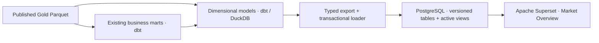

# HCMC F&B Data Platform

A Khánh Hội pilot integrating Overture and Google data into a traceable F&B catalog. M5 serves existing published Gold through a dimensional warehouse and Apache Superset; it does not rerun collection, identity matching or Gold integration.

## Architecture



Upstream flow: Overture + Google → Bronze → Silver → canonical ER → optional Human Review → Gold. Upstream integration changes are outside this M5 setup.

SQL/dbt owns dimensions, facts and transformations. The Python export/loader verifies hashes, lineage, grains and conservation before switching serving views atomically. Superset imports native dashboard assets and connects with read-only credentials. There is no custom chart framework, Redis or Celery.

## Business questions and models

- How many canonical records are observed, by area, category and source association?
- Where are they located, and what are their ratios against sourced area/population references?
- How many logical reviews exist, which have accepted store associations, and how do their ratings/dates vary?

[Dimensional modeling](docs/DIMENSIONAL_MODELING.md) defines the processes and grains. [BRD v1.5](docs/01_BRD.md) keeps data quality separate from business facts.

| Object | Grain |
|---|---|
| `dim_store`, `dim_category`, `dim_area`, `dim_date` | One current store, analytical category, sourced area, or day |
| `fact_store_snapshot` | One canonical store × Gold release |
| `fact_review` | One unique logical review, including unmatched reviews |
| `bridge_store_source` | One accepted source mapping × Gold release |

Seven models live only in `pipelines/dimensional_analytics`; three distinct marts remain in `pipelines/business_analytics`. dbt materializes DuckDB tables. The loader transfers verified results to `fnb_analytics.analytics_<bundle_id>` and switches `bi` views in one transaction. Failed refreshes preserve the previous active release; reruns verify rather than append.

## Verified pilot results

Gold release: `5d7915f7313e0da6dc10f1bb`.

| Metric | Observed result |
|---|---:|
| Overture-anchored canonical records | 725 |
| Accepted Google links / source-only records | 302 / 423 |
| Accepted source mappings / unresolved candidate pairs | 1,027 / 174 |
| Logical reviews | 10,139 |
| Attached / unmatched reviews | 6,942 / 3,197 |
| Gold category provisional / pending | 267 / 458 |

These are catalog records, not a census. Accepted links are machine decisions, not independently human-verified ground truth. Google aggregate Place ratings and collected individual review ratings remain separate metrics.

## Setup

### Prerequisites

- Docker Engine/Desktop with Compose v2 and Linux containers; PowerShell 7.2+ for the resumable runner.
- For browser verification: Python 3.11+ with `playwright==1.42.0` and installed Google Chrome at the verifier's default path, or run the verifier separately with `--chrome`.
- Authorized published inputs. Real Gold, Places/Reviews provenance, business marts and demographic reference releases are **not shipped in Git**. A clean clone cannot reconstruct source-derived data from code alone.

The single M5 file is `compose.analytics.yaml`; no Airflow or crawler container is required. It reuses the existing platform's service/volume names by default. On an existing installation, retain its secret files and volumes. Do not delete volumes, replace database secrets, or start another stack on the same ports.

### Configure and start

```powershell
# Copy only when .env is absent; edit local ports if needed.
if (-not (Test-Path .env)) { Copy-Item .env.example .env }
python -B scripts/init_analytics_secrets.py
# First build can take several minutes; execute in your own terminal.
docker compose -f compose.analytics.yaml build analytics-build superset-init
docker compose -f compose.analytics.yaml up -d postgres
docker compose -f compose.analytics.yaml run --rm analytics-init
```

`.env.example` contains ports, never credentials. Passwords and the Superset secret key are generated into ignored `.auth/fnb/` files and mounted as Docker secrets; existing values are never overwritten. `analytics-init` creates analytics and Superset metadata databases/roles without resetting PostgreSQL. Never replace secrets independently of an existing database.

The existing `docker/analytics/Dockerfile` has two targets: `warehouse` extends pinned Python with the project's pinned dbt/DuckDB dependencies and PostgreSQL driver; `superset` extends `apache/superset:6.0.0` only to install its PostgreSQL driver. PostgreSQL uses a pinned official image digest. No additional Dockerfile or orchestration framework is needed.

### Restore inputs, build dbt and refresh BI

Restore authorized publications into `fnb-platform_demo_outputs`, preserving their recorded `/demo/...` paths. Business marts mount from `.local/m3/dashboard` at `/business-input`; the demographic reference mounts from `output/area-demographics-silver-v1` at `/area-input`. Keep manifests, upstream Places/Reviews manifests and pinned artifacts together. Runner defaults describe the verified local pilot; pass its named release/hash parameters for another compatible snapshot. Missing or mismatched inputs are rejected, never synthesized.

```powershell
pwsh -File .\scripts\Invoke-AnalyticsWarehouse.ps1 -RunName m5-setup-01
```

This manual, resumable command verifies inputs, builds dbt, exports the warehouse, refreshes PostgreSQL twice, imports `docker/analytics/market_overview.zip`, starts Superset and checks charts/map/KPIs in Chrome. Logs, checkpoints and verification remain in ignored `.local/analytics/`. Same command resumes; changed pins/code require a new `-RunName`.

For an already verified warehouse export, refresh/import without rebuilding Gold:

```powershell
docker compose -f compose.analytics.yaml run --rm analytics-load --expected-gold 5d7915f7313e0da6dc10f1bb --result /analytics-out/manual-refresh.json
docker compose -f compose.analytics.yaml run --rm superset-init
docker compose -f compose.analytics.yaml up -d superset
```

Open **http://127.0.0.1:18088/superset/dashboard/hcmc-fnb-market-overview/**. Username: `portfolio_admin`; password stays in `.auth/fnb/superset_admin_password`. This is a local deployment. Edit charts in Superset and export using its native bundle format; remove connection passwords before replacing the versioned bundle.

### Verify and stop

```powershell
docker compose -f compose.analytics.yaml ps
# Require actual PASS, compatible pins and matching KPIs in local verification.json.
python -B scripts/verify_superset.py --output .local/analytics/manual-browser-check
# Stop only BI; keep PostgreSQL if shared with other workloads.
docker compose -f compose.analytics.yaml stop superset
# On a dedicated analytics installation, PostgreSQL may also be stopped:
docker compose -f compose.analytics.yaml stop postgres
```

Tests use synthetic fixtures and owned temporary schemas. Install the project's test/dbt dependencies to run analytics tests explicitly; the small default pytest selection is not M5 coverage. Live PostgreSQL tests require the existing localhost database and local admin secret. They do not replace a clean-install test.

**Verification boundary:** existing real-data PostgreSQL/Superset checks passed, including idempotent refresh, read-only access, 20 charts/3 tabs and map GRID/DETAIL behavior. The standalone Compose configuration is checked separately. A new empty-volume setup, new warehouse-image build and full clean-clone real-data execution are **NOT_VERIFIED** until actually run; authorized publications remain an external prerequisite.

## Data limitations

Only the supported Khánh Hội boundary has catalog coverage. Provider area/population references retain source, year, basis and WARNING status; they are not independently verified census figures. Unknown categories/dates remain unknown. Unmatched reviews stay separate; observed review activity is not venue-opening growth. No source review text, reviewer identities, credentials, raw captures or real datasets are distributed. Source redistribution rights are separate from the code license. Sentiment, recommendation and market-wide coverage claims are outside this MVP.
