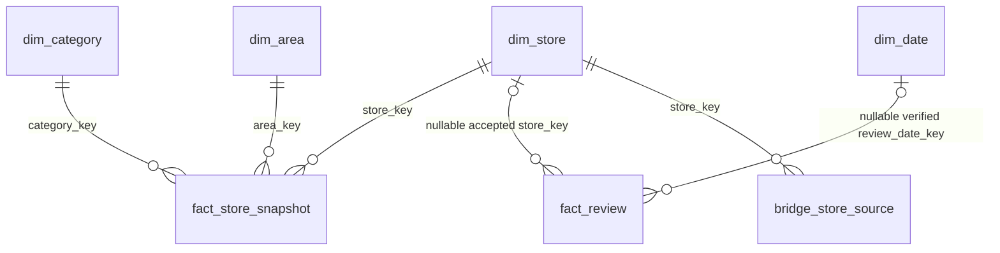

# F&B Dimensional Modeling — Analytics MVP

**BRD v1.5 Draft.** The base warehouse and pinned demographic/market handoff have passed actual execution. The business dashboard extends their serving views with thin read-only queries; it does not rebuild Gold or introduce new business facts. Runtime artifacts remain the authority for deployment sign-off.

Method reference: the operator-provided `23120298.PhamQuangMinh (1).pdf`, “BT#2: MODELING LOGISTIC”, 31 PDF pages; SHA256 `ccffc4e441add2142d2081fa8ac0bc54e1bafcdee655b11ac84141897f79bc0f`. Relevant PDF pages: 2–9 process/grain/dimensions, 9–20 measures/fact types/galaxy/KPI validation, 28–31 source-to-target mapping. The private reference is not redistributed. We reuse its reasoning sequence, not Logistics entities or example decisions. Unlike its special not-yet-occurred date member, absent review dates remain NULL as required here.

## 1. Business Questions

| Question | Business process / denominator |
|---|---|
| How many observed canonical records are in each area/category/status? | BP1; distinct catalog anchors in one selected Gold release |
| Where are they located, and which have accepted Google enrichment? | BP1; canonical coordinates and accepted source associations |
| How many observed catalog anchors per km² / 1,000 residents of the selected area? | BP1 numerator from current Gold; independent pinned provider reference denominator, not certified area/census or market completeness |
| What Google Place aggregate rating/count is available per accepted store? | BP1; valid fields from the exact pinned Places release, not collected review averages |
| How many logical reviews exist, which ratings do they have, and how do they vary over time? | BP2; each logical review once; time charts require verified publication dates |
| Which catalog anchors have at least one observed attached review? | BP1 with BP2 preaggregated to one store; observed review coverage, not complete Google review coverage |
| What remains unresolved, source-only, incomplete or unmatched? | DQ/audit reporting; no additional business process/fact |

## 2. Business Processes

**BP1 — Store Catalog Snapshot.** Publish a catalog state for one immutable Gold release. Keep 725 Overture anchors, source precedence/provenance and accepted attachments; an anchor is not independently verified physical-store truth. No cleaning/dedup/matching is repeated in analytics.

**BP2 — Customer Review Analytics.** Describe the current-known revision of each unique logical review from Gold's attached/unmatched partitions. Preserve the original typed Google identity even without an accepted canonical store. Repeated observations/collections are not new reviews.

ER quality/source reconciliation describe the integration process; they are audit views backed by admitted release controls, not a third business fact. Recommendation, sentiment, text analysis and ML are outside this implementation.

## 3. Grain Validation

| Relation | Grain / uniqueness | KPI and drill-down validation |
|---|---|---|
| `dim_store` | 1 current canonical store; unique original canonical ID | Descriptive drill-down without joining source/review rows into store counts |
| `dim_category` | 1 analytical category business key | Category grouping; Gold evidence remains on snapshot, not assumed by the dimension |
| `dim_area` | 1 supported area ID with source boundary evidence | Existing ward only; unsupported references fail the accounting gate rather than fabricate hierarchy |
| `dim_date` | 1 observed verified UTC publication calendar day | Year → quarter → month → day; use year+month together, not month alone across years |
| `fact_store_snapshot` | 1 `store_key × gold_release_id` | Count one anchor per selected release; never sum counts over releases |
| `fact_review` | 1 original `logical_review_id`; also unique `(source,source_review_id)` | One logical review across repeat collections; store/date may be NULL |
| `bridge_store_source` | 1 authoritative source association × Gold release | Source contributions at mapping grain, not additional stores |

Published logical IDs and canonical IDs are retained. Dimension surrogate keys are deterministic MD5 hashes of business keys; date keys are YYYYMMDD integers for real dates. PK/unique tests reject duplicates/collisions. Only one active warehouse version is exposed in BI. Archived versioned schemas are replay states, not extra business observations to UNION into a fact.

## 4. Dimensions

| Dimension | Business key → surrogate key | Attributes and source |
|---|---|---|
| `dim_store` | Gold `store_id` → `store_key`; original ID retained as `canonical_store_id` | Gold name, address, coordinates, identity status, human-verification flag, field provenance; current attributes, no SCD2 |
| `dim_category` | Existing mart `analysis_category` → `category_key` | Category key and readable name; unknown is an explicit category; no claim of verified taxonomy |
| `dim_area` | Existing `admin_area_id` → `area_key` | OSM boundary provenance plus one explicitly pinned demographic reference version/year for the supported ward; provider area/population remain separately named reference fields with source URL, basis, WARNING and release ID. `trusted_area_km2` remains NULL. No fabricated hierarchy or census |
| `dim_date` | UTC `published_at` date → `date_key` | full_date/day/month/quarter/year; admitted only when timestamp_status=VERIFIED; missing/ambiguous dates get no fabricated row |

Store is conformed across both facts. Category/area describe the selected store snapshot. Date is used only for the review publication date; first-seen/collection timestamps are not substitutes. Source `data_id` and `place_id` are preserved separately; a `data_id` is not relabelled as an official Google Place ID.

## 5. Facts & Measures

### BP1 — `fact_store_snapshot`

Keys: `store_key`, `category_key`, `area_key`, `gold_release_id`. Measures: `store_count=1`, accepted/source-only 0/1 flags, optional `google_rating`, optional `google_rating_count`. Evidence attributes include Gold canonical category/status, analytical-category basis/provenance, verification status and pinned Places release ID.

Google fields join only through Gold's published Google source mappings on typed identity. Valid Place ratings may contain decimals in [1,5]; count must be nonnegative. Missing/invalid fields remain NULL with status. Ratings on unaccepted Google candidates cannot enrich source-only stores. Acceptance remains unchanged when optional rating is absent.

### BP2 — `fact_review`

Fields: original logical/source review IDs, `google_id_kind`, `google_identity_value`, nullable accepted `store_key`, nullable `review_date_key`, optional `review_rating`, status/source of the date, `review_count=1`, source Reviews release and association Gold release.

Review stars are discrete 1–5; missing/out-of-domain values remain NULL/flagged while the review survives. Date derives only from verified `published_at`, in UTC. Gold association lineage and a hash of the original source provenance preserve traceability; reviewer names, review text and opaque raw diagnostics are not copied to the fact.

The canonical-store FK is NULL for unmatched reviews. All logical reviews still point to their original Google identity. A join to snapshot category/area additionally uses the association Gold release. A source-only catalog anchor is not an excuse to attach an unresolved Google review.

### Bridge and additivity

The bridge copies authoritative Gold mappings: 725 Overture anchor associations + 302 accepted Google associations = 1,027 rows. Non-accepted candidate pairs do not enter it. Decision source, policy, evidence hash and provenance remain available in the warehouse.

| Measure | Aggregation rule |
|---|---|
| store_count / link flags | Add across stores for one release; semi-additive across releases |
| review_count | Add across unique logical reviews, including unmatched/unknown-date buckets where applicable |
| review_rating | Non-additive; collected-review mean uses rated rows only, with rated count reported |
| Google Place rating/count | Store-snapshot fields; never substitute AVG(collected reviews), never call an unweighted AVG(store ratings) the mean of all Google reviews |
| review coverage | `100 × stores_with_at_least_one_attached_review / canonical_records`; calculated in PostgreSQL |
| attachment percentage | `100 × attached_logical_reviews / all_logical_reviews`; DQ metric, not market/source completeness |

No direct bridge→snapshot COUNT(*) join is used. `v_store_review_summary` preaggregates BP2 to one store before joining BP1.

## 6. Fact Types and Table Choices

- Store fact: **snapshot fact at the release boundary**; no fabricated daily cadence or accumulating lifecycle milestones.
- Review fact: **transaction grain / current-known logical review revision**; corrections replace the logical state through versioned refresh rather than append a collection duplicate.
- Bridge: source relationship, not a third business fact. `release_audit` is a technical load-control record, not a business process.
- Four dimensions support actual questions. No dim_rating (numeric measure), dim_reviewer (no reviewer question/PII requirement), sentiment fact, recommendation fact, SCD2, speculative hierarchy or duplicate aggregate-table family.
- Gold's 8-model/27-test build and existing 3 analytics marts are preserved. All 3 marts are copied from verified Parquet into the versioned serving schema; `mart_store_business` supplies the existing category projection. Seven new dimensional dbt models provide the missing grains; no Gold/dbt project is rewritten.

## 7. Star / Galaxy Schema



The two stars share the store dimension. Gold release IDs are degenerate snapshot/provenance keys; no extra dim_release is required for a one-active-release MVP. Measures from the two facts are aggregated at their own grains before comparison.

## 8. KPI Verification and Actual Status

Real pinned inputs: Gold `5d7915f7313e0da6dc10f1bb`, analytics `a833acfc5db7959f581354c1`, native Places `96815d7cf899140c08ace2d8`, native Reviews `da12735e7205df69b103ed5d`. Producer manifests, selected artifact SHA256 and lineage bind the handoff; no implicit latest input or source rerun.

| KPI | Definition / expected from Gold | Real read-only projection |
|---|---|---:|
| Canonical records | COUNT snapshot / SUM(store_count), one Gold release | 725 |
| Accepted / source-only | SUM of mutually exclusive flags | 302 / 423 |
| Published source mappings | COUNT bridge, at its own grain | 1,027 |
| Non-accepted pairs | Gold audit accounting, not a fact join | 174 (16 REVIEW_REQUIRED + 152 INSUFFICIENT_DATA + 6 NON_MATCH) |
| Logical reviews | COUNT fact_review | 10,139 |
| Attached / unmatched | store_key non-NULL / NULL | 6,942 / 3,197 |
| Gold category provisional / pending | Snapshot Gold evidence status, not analytical category | 267 / 458 |
| Valid Google rating/count on accepted stores | Non-NULL snapshot Google fields | 269 / 269; 33 accepted stores still lack these optional fields |
| Verified review dates / valid review stars | Non-NULL review_date_key / review_rating | 10,139 / 10,139 |

Production SQL derives expected values from the admitted Gold summary and audit artifacts, never literal pilot counts. DQ additionally exposes 182 AVAILABLE / 244 INCOMPLETE_METADATA / 34 MISSING_METADATA Places, missing addresses, taxonomy unknown and review-date/rating gaps.

Focused tests execute dbt models/data tests on synthetic inputs in the existing `/opt/dbt` Docker environment. Live PostgreSQL tests use fresh owned synthetic schemas/role only: load twice, verify row hashes/constraints, read-only view access, server GRID/DETAIL SQL and rollback before commit. They do not load real data into the production analytics database.

Historical read-only projection evidence: `.local/warehouse-analytics/real-projection.json`; 0.818 s and 314.96 MiB process peak. The base deployment passed `analytics-05`; the demographic deployment subsequently passed `analytics-market-03`. Scoped verification reused warehouse bundle `ce691583b45023f95aea865a`, reconciled real KPIs and passed native import/browser checks. These are local execution results, not a clean-clone installation claim.

## 9. Source-to-Target Mapping

| Source → target | Rule / responsibility |
|---|---|
| Gold `dim_store` → DW `dim_store` | Preserve canonical IDs/attributes/provenance; generate deterministic lookup key, no ER or recleaning |
| Existing `mart_store_business` → category dimension + snapshot category/area | Reuse analytical category, evidence basis and area assignment; Gold taxonomy status remains separate |
| Pinned OSM metadata/GeoJSON + Area Demographics Silver → `dim_area` | Match official ward code with CODE_AND_NAME_AGREE; one reference row per ward, preserve source version/year/basis/quality/release and hashes. Reference is reused independently of the old catalog staging release |
| Gold attached + unmatched → `fact_review` | UNION ALL selected non-PII fields, enforce unique logical/source keys; unmatched keeps NULL canonical FK |
| Verified published_at → `dim_date` + review FK | Same UTC date rule in both models; unknown stays NULL, never crawl/collection date |
| Gold source mapping → bridge | Copy authoritative mappings; reject duplicate/fanout keys; no proposal promotion |
| Accepted Google bridge + pinned Places → snapshot Google fields | Exact typed ID join; range-valid rating/count only; no fallback from review AVG |
| Gold summary/link audit + admitted metadata → `release_audit` / `v_data_quality` | Preserve grain-specific denominators; no new business fact |
| New models + 3 existing marts → PostgreSQL | Deterministic CSV/type projection and content hashes; structured mart attributes serialize to JSON text |
| PostgreSQL → Superset | Read-only SQL views; additive aggregation of SQL-defined measures, no independent KPI logic |

## 10. Serving, Refresh and Execution

`fnb_analytics` is a separate database on the existing PostgreSQL service. `fnb_superset` holds Superset metadata; neither uses Airflow/crawler tables. Each build has an immutable `analytics_<bundle_id>` schema; `bi.v_store_overview`, `bi.v_store_review_summary`, `bi.v_review_overview`, `bi.v_data_quality` and `bi.active_release` switch together in one transaction after hash/KPI checks. A failed load/switch rolls back; prior serving data remains. Rerun verifies the existing schema rather than appending. Old version schemas are retained.

PKs, business-key unique constraints, FKs, fact checks and indexes cover store lookup, category/area, review date/source identity and a latitude/longitude bounding box. `fnb_analytics_readonly` can read BI views but cannot access/write versioned tables; Superset metadata uses its own account. Secrets are generated only when missing into ignored local files. Query result caching is disabled for the MVP to avoid stale mixed-release KPI values.

Superset OSS is pinned to 6.0.0. Twenty selected charts/KPI cards/tables form three native tabs: **Tổng quan**, **Loại hình & địa điểm**, **Reviews quan sát**. Overview keeps five area KPIs, the Point Map, category/source composition and reference context. Venue detail adds rating bands, per-category Place medians with valid sample counts, review coverage and searchable individual records. Reviews show global logical totals/sample mean, store coverage, stars, attachment and monthly publication counts. Technical ER/DQ tables and duplicate cards remain stored but are excluded from this business dashboard; audit views stay available. The browser verifier visits every tab and checks fresh GRID/DETAIL responses.

PostgreSQL `bi.v_catalog_profile` remains one canonical store, `bi.v_review_profile` remains one logical review, and `bi.v_review_kpi` produces one current-release summary. Superset uses these physical views through its read-only connection, with native filters applied before category aggregation. Place medians use valid per-store ratings with N; the logical-review mean uses individual observed reviews. No average of Place means is presented as an all-review rating. Global review counts preserve unmatched reviews; monthly review activity is not a business-opening trend.

The sole dimensional implementation is `pipelines/dimensional_analytics`: seven dbt models materialized as DuckDB tables. `pipelines/business_analytics` retains only its three distinct business marts. The existing export/transactional loader transfers typed results into PostgreSQL; there is no additional Python modeling or chart framework. `docker/analytics/market_overview.zip` is the native, data-free Superset export, imported by a small connection/bootstrap script. Chart changes are edited/exported in Superset; catalog/review SQL lives in `serving.sql`. The map alone uses a native virtual query for filter-aware bounded detail/grid selection.

A single supported area is selected by default for bounded DETAIL. Clearing the area filter or requesting too many stores uses server-side 0.01° GRID aggregation; grid bubbles are not density/km² or actual store positions. The muted Stadia Alidade Smooth basemap requires attribution/network; localhost development needs no API key, while public deployment requires provider authentication. Store points are colored by source association, never human verification. Tooltips escape source fields.

`bi.v_area_market` has one row per supported area/current Gold/pinned reference version. It publishes observed catalog counts, provider-reference population and km², observed anchors/km², anchors/1,000 residents and reference population density. Missing/zero denominators yield NULL; provider values are not upgraded to trusted/census status. Only the current Gold's 725-anchor catalog supplies numerators; the old Area Enrichment staging store counts are not reused. No additional business fact or matching step is introduced.

Run from repository root, PowerShell 7.2+, existing Docker runtime/inputs and Python with Playwright + installed Chrome:

```powershell
pwsh -File .\scripts\Invoke-AnalyticsWarehouse.ps1 -RunName analytics-simplified-01
```

The standalone `compose.analytics.yaml` defines PostgreSQL, a warehouse image for dbt/loader and Superset; Airflow is not required. The existing analytics Dockerfile has separate warehouse and Superset targets. Initialize local secrets, build images and start PostgreSQL using the README steps first. The operator-run job checkpoints/resumes dbt, loads twice, checks read-only credentials/KPIs, imports native BI assets and verifies chart queries, street tiles and GRID→DETAIL behavior in Chrome. It preserves logs and prior verification. Changed pins/code require a new `-RunName`. A fresh warehouse-image build, empty-volume setup and full clean-clone execution remain **NOT_VERIFIED**; authorized published inputs are external prerequisites.

Actual evidence goes to `.local/analytics/verification.json`, per-stage logs/checkpoints and browser screenshots. It reports build-driver/dbt-child peak memory, sampled Superset/shared-PostgreSQL container memory and five-query timing samples; sampled serving memory is not an isolated peak. Target local URL after successful execution: `http://127.0.0.1:18088/superset/dashboard/hcmc-fnb-market-overview/`. It is not a public deployment. Username: `portfolio_admin`; password stays in `.auth/fnb/superset_admin_password`.

AGENTS long-job rules require manual execution for the full runner. Real-data warehouse/dashboard execution has passed; scoped refresh, native asset import and browser checks are verified separately after changes. No crawler, ER, Gold, historical releases, volumes or crawler/smoke changes are modified. Source Google/review redistribution rights and independent identity accuracy remain separate unresolved constraints; no raw reviews or reviewer identities are distributed as a demo dataset.

Implementation references: [dbt project](../pipelines/dimensional_analytics), [warehouse export](../src/fnb_platform/analytics/warehouse.py), [transactional loader](../scripts/load_analytics.py), [serving SQL](../docker/analytics/serving.sql), [Compose](../compose.analytics.yaml). Superset configuration follows the official [Docker build/driver guidance](https://superset.apache.org/user-docs/6.0.0/installation/docker-builds/) and [Deck.gl source examples](https://github.com/apache/superset/blob/6.0.0/superset/examples/deck.py).
