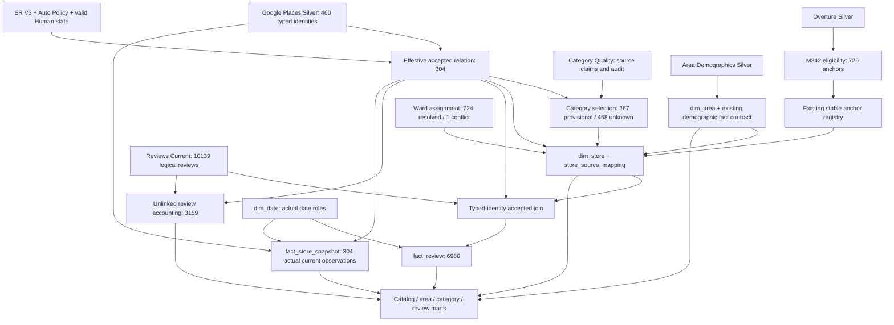

# Silver Integration Readiness Gate V1

Ngày audit: 09/11/2026 (UTC). Phạm vi: artifacts local, audit và thiết kế contracts;
không chạy crawler, build Gold mới, sửa source releases hoặc import quyết định.

## 1. Kết luận và phạm vi READY

- **Technical source readiness: READY.** Các nguồn dưới đây có thể được tích hợp
  trong một Gold **staging** build có kiểm soát, giữ trạng thái chưa xác minh.
- **Official/production Gold publication: NOT_READY.** Active mapping hiện chỉ có
  `activation_scope=GOLD_STAGING_ONLY`; mẫu kiểm định 48 links chưa có human labels,
  chưa có đánh giá matching độc lập đáp ứng SRS FR-18/AT-10. Chưa xác minh được hồ
  sơ quyền sử dụng/công bố Google trong các manifest đã kiểm tra. Không suy ra
  quyền công bố từ việc có crawler, dữ liệu hoặc operator flag.
- **6.980 logical reviews** có thể gắn vào **265 anchors có reviews** thông qua
  304 accepted links hiện hành, trong phạm vi staging và dưới nhãn machine-accepted.
  **3.159 reviews** chưa được gắn canonical store, vẫn phải được accounting.
- Các vấn đề category/area chưa giải quyết được giữ `unknown`/`PENDING`/unknown
  dimension member; không bắt buộc xử lý hết để build staging, không được trình
  bày chúng là dữ liệu đã xác minh. Không tự bỏ những reviews đó.

Baseline nghiệp vụ đọc trực tiếp: [BRD v1.4 Draft](01_BRD.md),
[SRS v1.1 Draft](03_SRS.md), đều ngày 05/11/2026; BRD v1.3 là baseline làm việc
cũ, không phải bản phê duyệt. PRD alignment vẫn pending. Không nhập yêu cầu từ BRD
Market Intelligence riêng. Reviews trong BRD/SRS là giai đoạn sau; task hiện tại
mở rộng **thiết kế** Gold có reviews, không tự thay đổi điều kiện nghiệm thu MVP.
Point Map/phân tích loại hình-khu vực vẫn bắt buộc; Density Map tùy chọn; sentiment,
ML và recommendation không thuộc gate này. Không tự thêm precision/performance SLA.

## 2. Active releases đã pin và verify

Các đường dẫn `output/...` dưới đây thuộc pipeline worktree. Overture Silver
duy nhất thuộc original worktree, được đọc nguyên trạng:
`D:/Projects/integration-recomentdation-fnb-data-platform-20261028`.

| Nguồn / dependency | Active release | Rows chính | Technical readiness / giới hạn |
|---|---|---:|---|
| Overture Silver | `2026-10-21.0` | 6.199 | READY; 725 candidates không phải 725 physical stores đã xác minh |
| M242 Eligibility | `3bf02697d8f1d8fc34ccb752` | 725 candidates; 6.199 eligibility rows | READY; giữ 557 + 168 |
| Google Places Silver M1 | `bc742a4d46f7e312cd248550` | 460 identities; 476 candidate links | READY; 34 `MISSING_METADATA` phải giữ trạng thái thiếu, không làm successful snapshots |
| Google Reviews Silver V1 | `41707b889027baa29d79ffab` | 10.929 observations; 10.139 current reviews | READY; collection coverage không đầy đủ |
| Area Demographics Silver V1 | `edd1b24eec37b96c9c6fc430` | 168 | READY cho reference có qualifier dân số đề án |
| Category Quality V1 | `cc9abcfc1a3253663d6eca00` | 6.659 normalization; 6.201 audit | READY cho provisional category selection; không phải verified taxonomy |
| Effective Identity Mapping active | `7a16178c72ce853d765fdb56` | 476 | READY cho staging; NOT_READY cho production do activation scope |
| Ward Assignment / Area Staging | `75f6e7a758c56a41f2846a21` | 725 assignments; 168 area rows | READY với một AREA_CONFLICT giữ unknown |
| Existing Catalog Gold Staging | `0663f39a41029412f2d36494` | 725 anchors; 1.029 source attachments | READY làm registry/selection reference; không phải production Gold |

### Manifest pins

| Release root | Manifest SHA256 |
|---|---|
| Original `output/overture-silver-m241/releases/2026-10-21.0` | `781663680154984d167b6582658ec6a467fd394293d20d94915491ef3955f0c7` |
| `output/overture-fnb-eligibility-m1/releases/3bf02697d8f1d8fc34ccb752` | `4f10ee3a5b9887e7a39b78b40811e8f6e1d8287a6ba65262e90e71a269504c70` |
| `output/google-silver-m1/releases/bc742a4d46f7e312cd248550` | `40a147dd2b5f16b837697ecbad8c1671e2ac7ae5d6a4bda39be015f50679d6fd` |
| `output/google-reviews-silver-v1/releases/41707b889027baa29d79ffab` | `7095ab1d3d86b7d431d8db568833cef11c2f5361ef99ab6f13d71615fcb11292` |
| `output/area-demographics-silver-v1/releases/edd1b24eec37b96c9c6fc430` | `8259fb49259ed2d8d1d98bf111822f8912dbf6b49534bda5e066beeca4160a3e` |
| `output/category-quality-v1/releases/cc9abcfc1a3253663d6eca00` | `295ef3e074349d6721449e36ff1f6f5a2a3a49a6878cb47ff34d0dba1a4b8390` |
| `output/effective-mapping-active-v1/releases/7a16178c72ce853d765fdb56` | `dc7e0e18dfbadb375236614e97e8c1f75ef42ac603f627361d6012509e75c3cd` |
| `output/area-enrichment-staging-v1/releases/75f6e7a758c56a41f2846a21` | `438e28abe59ef67acadf6c303b74b497ecbec32f9c9d6051b7734115d35559a2` |
| `output/gold-staging-v1/releases/0663f39a41029412f2d36494` | `b41633fbe91ba58b46659f07165d28618b124414a25d15d96565876bc551ea33` |

Kiểm tra đã thực hiện bằng các verifier hiện có và assertions read-only:

- Pointer → manifest checksum; artifact byte checksums, rows và schema; logical
  hashes khi contract release hỗ trợ. Overture dùng `consumer.verify_silver`;
  M242 dùng verifier riêng, gồm subset equality candidates/eligibility.
- 13.892 distinct absolute input/code file references từ bảy manifests hiện đại:
  **0 missing, 0 checksum mismatch, 0 inconsistent expected hashes**. Các relative
  input/code hashes của M242 cũng được đối chiếu theo input root của nó.
- Schema trọng yếu: Overture current-state 27 columns; M242 candidates 32;
  Google Places 42; source links 23; effective mapping 45; category normalization
  24/audit 34; demographics 24; review observations 38/current 27/bridge 11/
  inventory 30; ward assignment 28; staging dim_store 33.
- Kiểm tra required keys, uniqueness/FK, enum category, phạm vi rating/coordinates,
  demographic values/density, timestamp order và typed Google identities trực tiếp
  trên dữ liệu thật, không chỉ dựa vào test success trước đó.
- Các active pointer được pin transitively giữa Category/Mapping/Reviews/Area/
  Catalog khớp nhau. Human pointer được active mapping ghi là absent; hiện vẫn
  absent. Không có human decision mới bị bỏ qua.

Một số data-file pins quan trọng, đủ đối chiếu lại grain và đường nối:

| Artifact | SHA256 |
|---|---|
| Overture `current_state.parquet` | `853c3f76b85071c6e1c4e8567db8fc9e0ff24cf1aa2ef339467fa9add0c1f1fd` |
| M242 `candidates.parquet` | `d9e84cd70df0ceace6e32f631f072b88e370919728a9319036867d33ae765747` |
| Google `silver/google_places.parquet` | `fe748a134cb8a0bb4074ce340636846b775e08157578d451f5cf85887c871bad` |
| Effective `effective_identity_mapping.parquet` | `dfebc549a3a4e6476793022b38b648f40a1fb1abe221689cc33e5838fc6b1584` |
| Reviews `silver_reviews_current.parquet` | `ce78de3fb49906ff34b6bc3370e4a721dec45d6576aef5297609a5e725ead7e3` |
| Area `area_demographics.parquet` | `fd52495b0c7a1b2a02c66f9d254f571558d86d067d5bef8c2a4c3801f05cf6a2` |
| Ward `ward_assignment.parquet` | `ce7284c3db2fa8de1a71f63637549cecfb3960a4a32011724c74c1d2d37ffca6` |

Source/rule versions: Overture `2026-10-21.0`; eligibility
`m242-hierarchy-v1-provisional`; Google `google-silver-technical-v1`; ER proposal
`6d61dc52aee95b95f68c6699`; auto policy `er-auto-accept-v1`, active wrapper
`er-effective-gold-staging-v1`; category `category-taxonomy-v1` /
`category-quality-v1`; reviews `google-reviews-silver-v1`. Google is 12 frozen
crawl runs, không phải một source release có thời điểm đo đồng nhất.

Area provider source version:
`diachiviet:2026-11-05:0b851ae1015a4755bd4a4a3509c06f82cc01569e0c611f2de662fc9cb709546d`.
Reference year 2025; population basis `2025_REORGANIZATION_PROPOSAL_NOT_CENSUS`.
Boundary version:
`8303300ecfb3ebc968ea70010d6c2e27cad16716a0ad175dbd6f6e47e5b68684`;
chỉ có polygon Khánh Hội, không có polygon cho toàn bộ 168 đơn vị.

## 3. Identity graph và source coverage

### Reconciliation theo đúng grain

| Thành phần | Số lượng / cách hiểu |
|---|---|
| Overture Silver | 6.199 source POIs; 725 thuộc catalog baseline, 5.474 ngoài baseline |
| Eligibility baseline | 557 taxonomy ban đầu + 168 hierarchy additions = 725; không thêm POI mới |
| Overture có candidate links | 474 unique IDs / 476 links |
| Overture chưa có Google candidate | 251 |
| Accepted | 304 AUTO_ACCEPTED; 0 HUMAN_ACCEPTED |
| Chưa accepted | 132 PENDING links + 40 CONFLICT links; 170 unique Overture IDs |
| Source-only catalog anchors | 421 = 251 chưa candidate + 170 có unresolved links |
| Google identities | 460 = 304 assigned + 156 unassigned |
| Store source attachments | 1.029 = 725 Overture + 304 Google |
| Logical reviews | 10.139 = 6.980 canonical-attachable + 3.159 held/source-only |

Không có accepted link shared Google ID, multiple accepted candidates cho một
Overture ID hoặc dangling accepted source key. Registry 725 IDs trùng chính xác
anchor set của M242/Category baseline. Google attachments trong staging trùng chính
xác accepted typed identities. Mỗi source attachment trỏ tới một anchor tồn tại.
Không gộp các Overture IDs để giải quyết source-level duplication.

### Review accounting, partition exclusive theo Google identity

| Effective group | Google identities | Logical reviews |
|---|---:|---:|
| Accepted | 304 | **6.980** |
| PENDING, không có accepted/conflict | 123 | 2.214 |
| Có CONFLICT, không có accepted | 33 | 945 |
| Tổng | **460** | **10.139** |

Group CONFLICT được ưu tiên khi một Google identity có cả PENDING/CONFLICT links;
đây chỉ là accounting partition, không sửa effective statuses của từng link.
Trong accepted group, 265 identities có reviews, 39 chưa có current reviews.
Trong unassigned group, 104 identities có 3.159 reviews, 52 chưa có current reviews.
Reviews không có accepted canonical attachment vẫn còn nguyên trong Silver và
phải có unlinked accounting view/mart; không tự tạo store hoặc gắn Unknown Store.

### Join contracts và kiểm tra fanout

1. Tạo accepted relation từ effective mapping, chỉ lấy `AUTO_ACCEPTED` /
   `HUMAN_ACCEPTED`, kèm activation scope, policy version, evidence và machine/human
   status. Human NON_MATCH/UNSURE hoặc pending/conflict không được vượt gate.
2. Join `overture_id` vào registry/anchor ID. Join Google bằng **cả**
   `(google_id_kind, google_identity_value)`, rồi logical reviews bằng typed key đó.
   Không dùng tên, address, score hoặc crawler store_id làm integration key.
3. Accepted relation phải unique cả `overture_id` và typed Google key. Một logical
   review chỉ nhận một `store_id` trong một Gold release. Kết quả thực tế: 6.980
   attachments, 6.980 unique logical review keys, không duplicate.
4. Google typed key có 16 shared-ID groups trong toàn bộ candidates. Nối reviews
   qua mọi 476 candidate links sẽ tạo **10.797 rows**, làm **658 logical reviews
   xuất hiện hai lần**. Không dùng graph candidate này cho fact hoặc metrics.
5. Aggregation reviews phải thực hiện ở typed Google identity/store grain trước
   khi join vào catalog mart. Kiểm thử preaggregation giữ đúng **725 catalog rows**,
   tổng attached review count vẫn **6.980**. Join store → reviews là quan hệ 1:N
   hợp lệ, nhưng không được COUNT(*) để tính số stores sau phép join đó.
6. Không nối đồng thời raw metadata history, review observations hoặc future
   multi-category bridge vào facts mà không khai báo grain/aggregation tương ứng.

## 4. Category và area reconciliation

### Category

- 6.659 normalization rows = 6.199 Overture + 460 Google. Category audit có 476
  linked pairs và 5.725 source-only rows; các số này không phải canonical store count.
- Linked relations: 356 CONSISTENT, 81 SOURCE_ONLY, 30 SUBCATEGORY_DIFFERENCE,
  **9 CATEGORY_CONFLICT**. 50 links có comparison status NEEDS_IDENTITY_RECHECK,
  không phải 50 category conflicts; có shared/multiple/identity warnings.
- Trong 304 accepted links: **267 CONSISTENT, 23 SOURCE_ONLY, 14 subcategory
  differences; 0 CATEGORY_CONFLICT**. Không thấy severe category conflict lọt
  qua auto policy.
- Staging canonical categories: **267 PROVISIONAL_SOURCE_AGREEMENT**, **458
  unknown/PENDING**. 458 = 421 source-only anchors + 37 accepted links chưa chọn
  được canonical category theo field policy hiện hành.
- 6.308 attachable reviews thuộc selected provisional categories; **672** thuộc
  category PENDING. Không bỏ 672 reviews này; đưa vào Unknown category khi phân tích.
- Cả 725 baseline Overture POIs và 460 Google identities đều hiện có tối đa một
  normalized category. **Chưa cần physical multi-category bridge trong minimum V1**.
  Source category arrays/provenance vẫn phải giữ để không đóng đường hỗ trợ nhiều
  category sau này.
- Full-source warnings: 29 name-hint taxonomy exclusions (10 trong ward), 330
  missing-category flags, 4.005 unrecognized-category flags. Đây là flags trên
  source observations rộng hơn catalog, không phải số candidate cần loại.
  Google có 80 unknown-category identities; canonical unknown không đồng nghĩa
  source category unknown. Không auto-add các name hints vào 725 baseline.
- Overture có 1.592 broad FNB_CANDIDATE trên cả vùng trích xuất; 867 nằm ngoài
  baseline. Không dùng con số 1.592 để âm thầm mở rộng Gold catalog.

### Area

- 168 codes/names hợp lệ theo reference đối chiếu QĐ 19/2025; 168/168 có area và
  population. Dữ liệu Địa Chỉ Việt được giữ là proposal/reference, không là census.
- 725 assignments: **724 RESOLVED / 1 AREA_CONFLICT**; 274 ADDRESS, 450 SPATIAL,
  một UNRESOLVED. Phân bố: **722 Khánh Hội, 1 Vĩnh Hội, 1 Xóm Chiếu, 1 unknown**.
- 77 near-boundary flags; 2 outside-supported-polygon flags. Các ward khác có
  thể được resolve bằng exact address lookup, không giả định có polygon tương ứng.
- Conflict thật: `Gà Quay Thiên Phúc 55 - Q4`, store
  `store_c22baed0326252078d81c10946dcebfd`; địa chỉ ghi Vĩnh Hội (`27286`), spatial
  lookup Khánh Hội (`27265`); final area NULL. **8 attachable reviews** của anchor
  này phải giữ Unknown area, không tự gán một bên và không tự đổi ER decision.
- Trong 6.980 attached reviews: **6.934 Khánh Hội, 38 Xóm Chiếu, 8 unknown**.
  Vì vậy “reviews gắn canonical anchors” khác “reviews theo current Khánh Hội”.
- Hai anchors có current area ngoài Khánh Hội vẫn ở catalog baseline 725 để
  accounting, không bị xóa. Mart/Point Map phải khai báo original eligibility
  scope và current geographic filter; không mặc định mọi anchor thuộc Khánh Hội.
- Reference version/year và boundary version là các trục khác nhau. Không join
  demographic history bằng ward_code đơn lẻ khi có nhiều source versions.

## 5. Review timestamps và snapshot semantics

- 10.929 persisted events → 10.139 logical current reviews. 740 reviews có nhiều
  observations, 9.399 chỉ có một. Không biến observations thành reviews mới.
- 55 logical reviews có nhiều content hashes; 110 observations mang flag variation.
  Toàn bộ raw `event_type_original` vẫn là INSERT. Không suy ra verified edit,
  UPDATE hoặc DELETE từ những dữ liệu này. Absence ở capture sau không phải deletion.
- 10.139 current reviews có timestamp_status VERIFIED theo CDP parser, 0 vi phạm
  `published_at <= last_modified_at <= last_observed_at`, first_seen <= last_observed.
  VERIFIED ở đây là timestamp parsing evidence, không là identity/human verification.
- Published UTC range: `2013-04-05T17:03:24.161902Z` đến
  `2026-11-05T14:04:03.671376Z`. Persisted first-seen sớm nhất
  `2026-11-04T16:09:03.314320Z`; last observed lớn nhất
  `2026-11-05T16:49:16.026666Z`. Review publication trong năm 2013 không có nghĩa
  platform có store/rating snapshots từ năm 2013.
- Current review là **nội dung/rating hiện quan sát được** của logical review, có
  thể được nguồn chỉnh sửa. Group theo published year chỉ là current reviews được
  xuất bản trong năm đó, không phải rating đã biết tại thời điểm lịch sử ấy.
- 2.940 current reviews thiếu/empty text vẫn giữ. Không backfill text cũ vào NULL;
  không đổi relative date thành exact timestamp.
- Accepted Google metadata: 304 current observation IDs; 296 identities chỉ có
  một metadata observation, 7 có hai, 1 có ba. Không dựng time series giả. V1
  snapshot contract dưới đây chỉ dùng **current actual observation** của mỗi
  accepted identity, không mở rộng toàn bộ raw history trong task này.
- 270/304 có cả reported rating và review count; 34 thiếu cả hai, giữ NULL. Toàn
  bộ 270 measure pairs có cùng field-provenance observation ID, khớp current
  observation, không dùng fallback cũ. Accepted rows không có metadata conflict.
  Các current snapshot times nằm trong `2026-11-05T04:31:14.393463Z`–
  `2026-11-05T16:21:22.485988Z`. Đây là thời điểm nguồn quan sát, không phải ngày
  chạy audit hoặc ngày publish Gold.
- Báo cáo provider rating/review_count khác collected-review average/count. Không
  giả lập provider count bằng số reviews đã thu; không gắn số reviews thu muộn hơn
  vào metadata capture cũ để tạo giả một lịch sử coverage.

## 6. Gold V1 contracts đề xuất — chưa implement

Các contracts này phục vụ BR-02/03/05/06 và FR-10–17; review extension liên quan
BR-09/FR-20. Giữ source identity, field provenance, verification và completeness.
Không đồng nghĩa các bảng đã tồn tại ở production.

### 6.1 `dim_store`

- **Business question:** Catalog/Point Map có những POI anchors nào, thông tin
  đại diện đến từ đâu, trạng thái identity/category/area ra sao?
- **Grain:** một baseline Overture anchor trong một pinned Gold release; chưa
  khẳng định unique physical business vì ER-B/đánh giá physical dedup chưa hoàn tất.
- **Keys:** reuse stable `store_id` từ registry 725 anchors; alternate key
  `overture_id`. Không row_number, name hash hay Google ID làm canonical store ID.
- **Attributes/dimensions:** display name/address, valid coordinate pair,
  identity decision source/status, FNB candidate status, representative category
  FK, current area FK, assignment status, field/source provenance, input/rule versions.
  Unknown operating state không thành closed. Không coi AUTO_ACCEPTED là HUMAN_VERIFIED.
- **Measures:** không chứa measures cộng dồn; anchor count = COUNT DISTINCT store_id.
- **Sources/policy:** reuse existing staging selection: accepted non-NULL Google
  fields, else Overture; category theo rule hiện hành; area từ pinned assignment.
- **DQ:** exactly 725 keys; original source coverage; pairwise coordinates valid;
  provenance cho mọi selected field; pending/conflict không gắn Google; unknown
  category/area có biểu diễn rõ; no unauthorized merge.

### 6.2 `dim_date`

- **Business question:** Review được nguồn công bố/chỉnh sửa/quan sát ngày nào;
  metadata snapshot được quan sát ngày nào?
- **Grain/key:** một calendar date; deterministic YYYYMMDD key, reserved unknown
  member key 0 với date NULL. Không dùng ngày 1970 giả để lấp missing.
- **Attributes:** date/year/month/day và calendar labels thông thường; không tự
  thêm holiday, fiscal calendar hoặc business calendar chưa có yêu cầu/nguồn.
- **Roles:** published_date, modified_date, first_seen_date, last_observed_date,
  source_snapshot_date. Giữ timestamp gốc UTC; reporting dates được chuyển nhất
  quán sang Asia/Ho_Chi_Minh. Gold publication date là lineage riêng, không thay
  source observation date. Demographic reference year không biến thành ngày giả.
- **Measures/source/tests:** dimension không measures; generate từ actual required
  date range, unique date/key, UTC→local conversion đúng, NULL→unknown, valid FKs.

### 6.3 `dim_area`

- **Business question:** Anchor/review thuộc administrative area nào theo evidence
  hiện hành, mã và tên gì, có boundary nào hỗ trợ?
- **Grain/key:** một ward_code trong pinned reference version; reuse area_id hiện
  có. V1 có 168 real members; có thể thêm reserved Unknown member để giữ NULL area
  trong dimensional joins, không tạo ward code/name giả.
- **Attributes:** ward/city codes/names, reference/source versions, code-validation
  status, boundary availability/version khi có. Assignment method/conflict là
  thuộc tính store-area link, không là thuộc tính chung của cả ward.
- **Measures:** không duplicate population qua stores/reviews. Reuse logical
  `fact_area_demographics` hiện có ở grain area × reference_year × source_version
  cho area_km2, population, population_density và proposal basis.
- **Sources/tests:** Area Silver + boundary metadata; unique area/code trong một
  pinned version, referential integrity; không gọi 168 reference areas là 168
  available polygons; area/pop NULL/validity và demographic-grain uniqueness.

### 6.4 `dim_category`

- **Business question:** Phân tích theo category chuẩn hóa nào và đang chọn trên
  cơ sở nguồn/validation nào?
- **Grain/key:** một existing category code trong mapping version. Stable key từ
  category code + mapping version; unknown member là code `unknown` có sẵn.
- **Attributes:** existing nine groups: restaurant, cafe_coffee, beverage,
  bakery_dessert, fast_food, bar, other_food, non_fnb, unknown; mapping/rule version.
  Validation/provenance của từng store-category selection không bị nâng thành
  thuộc tính “category này đã verified” cho toàn bộ dimension.
- **Measures/source:** không measures; source là Category Quality mapping/config.
  Canonical selection V1 giữ 267 provisional agreement / 458 unknown, không tự
  ưu tiên nguồn hoặc dùng category agreement để xác nhận ER.
- **DQ:** valid enum, unique code/version, no unrecognized→other_food fallback,
  unknown không trình bày như verified classification, selected category có provenance.

### 6.5 `bridge_store_category` — conditional, chưa cần materialize trong V1

- **Business question:** Một store thuộc nhiều selected categories nào mà không
  mất membership hoặc nhân bản store/review totals?
- **Grain/key khi cần:** store_id × category_id trong một pinned selection version;
  composite unique, FKs hợp lệ; lưu selection status/source/rule/provenance.
- **Measures:** membership flag; không tự đặt allocation weights chưa được thống
  nhất. Category-level distinct counts có thể overlap; không cộng subtotals để
  suy ra grand total stores/reviews.
- **Source/activation:** chỉ selected category memberships theo accepted policy,
  không UNION mọi nhãn raw thành canonical categories. Hiện dữ liệu không có
  multi-category trong 725 Overture baseline hoặc Google; minimum V1 dùng category
  FK, vẫn giữ source arrays. Khi có multi-category thật phải bật bridge contract
  trước khi bỏ scalar assumption; không chọn arbitrary first category.
- **DQ:** unique membership, no source-only evidence presented as verified,
  explicit count-distinct aggregation và fanout tests với fixture multi-category.

### 6.6 `store_source_mapping`

- **Business question:** Canonical anchor lấy từ source records nào và vì sao
  Google attachment được chấp nhận?
- **Grain/key:** một source typed identity attachment trong pinned Gold release;
  key `(source, source_id_kind, source_id)` unique; store_id FK. V1 expected 1.029
  rows: 725 Overture source anchors + 304 Google accepted attachments.
- **Attributes:** link/effective status, decision_source, machine/human status,
  policy/mapping release, evidence_hash, source observation/release provenance.
- **Measures:** attachment count không phải store count; một store có nhiều sources.
- **Sources/tests:** registry + effective accepted mappings; all 725 Overture IDs,
  exactly 304 eligible Google keys, no shared Google assignment/multiple accepted
  candidates, no dangling store, correct human override/scope checks. Pending,
  rejected và conflict links ở accounting, không xuất thành trusted attachments.

### 6.7 `fact_review`

- **Business question:** Có bao nhiêu logical reviews đã thu có accepted attachment,
  rating/text availability thế nào theo current catalog và review publication date?
- **Grain/key:** một `(source, source_review_id)` current logical review, trong
  pinned Gold release. Stable review key từ logical source key, không observation ID
  hay crawler store ID. Expected **6.980 rows**, không 10.929 observations.
- **Dimensions/lineage:** store_id qua accepted typed-key relation; source typed
  Google identity; published/modified/first-seen/last-observed date roles; current
  observation ID, identity mapping release/evidence, Reviews release, timestamp/DQ
  status. Area/category context là **current catalog**, không suy ra historic ward,
  category hoặc accepted identity validity tại ngày review được nguồn công bố.
- **Measures:** review_count=1; nullable rating_value; rated_review_count và
  text_present_count. AVG rating = SUM(non-NULL rating)/COUNT(non-NULL rating),
  không average-of-averages. Text/author/profile không cần copy vào dimensional
  fact để đếm/rating; giữ reference về Silver, chỉ expose nội dung khi có nhu cầu
  nghiệp vụ và quyền dùng phù hợp. Không thêm sentiment trong V1.
- **Sources/tests:** Reviews Current, accepted mapping, registry và date dimension;
  key uniqueness; exactly one accepted store per review; source/FKs/rating/time
  valid; whole-observation selection/provenance; no observation inflation;
  `6.980 + 3.159 = 10.139` với hai key sets disjoint và union đầy đủ.
- **Accounting:** 3.159 held reviews vẫn có source-only/unlinked accounting view
  từ Silver, với PENDING/CONFLICT group và source refs. Không tạo giả Unknown Store
  để lách accepted-only attachment gate. 672 category-pending và 8 area-conflict
  attached reviews vẫn giữ trong fact và Unknown dimension context.

### 6.8 `fact_store_snapshot`

- **Business question:** Google báo rating/review_count của accepted anchor là gì
  tại actual metadata observation đang dùng? Phân biệt số Google báo với số đã thu.
- **Grain V1:** một accepted store attachment × **actual current Google metadata
  observation**. Natural event key `(source, google_id_kind, google_identity_value,
  source_observation_id)`; store_id là mapping FK, không tạo event mới khi đổi
  mapping hoặc republish. Expected 304 current snapshots, 270 có reported measures,
  34 giữ NULL. 421 source-only anchors vẫn ở dim_store/accounting, không có Google
  observation thì không fabricate Google snapshot cho chúng.
- **Dimensions/lineage:** store_id, source observation date/time UTC, typed identity,
  metadata observation/hash/path, mapping and source release, metadata/DQ status.
  Snapshot area/category context nếu cần phải là documented selection context,
  không tự dựng SCD2 history. V1 không khẳng định có historic dimensions.
- **Measures:** reported_rating, reported_review_count, snapshot_count=1. Chỉ dùng
  rating/count có cùng source observation provenance. NULL không thành 0; current
  collected review counts ở review coverage mart, không backdate vào metadata fact.
- **Sources/tests:** pinned Google Places current + field provenance/actual
  observation refs, accepted relation, registry; unique natural snapshot key,
  304 keys one-to-one with accepted metadata, 270 coherent measure pairs/34 NULL;
  valid ranges; no synthetic daily rows/history, no observations from unaccepted
  identities attached to stores. Raw historical metadata expansion là phase sau.
- **Additivity:** snapshot_count đếm observations, không đếm stores; reported count
  là stock, không cộng qua thời gian; reported rating không additive. So sánh các
  stores cần nêu capture times/denominators; không trộn các capture khác ngày thành
  một census snapshot hoặc dùng collected-review mean thay provider rating.

## 7. Analytical marts và aggregation contracts

| Mart / câu hỏi | Grain | Measures / source | Gate và giới hạn |
|---|---|---|---|
| Catalog by area/category: bao nhiêu anchors đang quan sát? | Gold release × current area × canonical category; source-category view tách riêng khi dùng nhãn Overture | DISTINCT store_id từ dim_store; selected/unknown/source-only/identity statuses | Tổng base 725; giữ Unknown và outside-current-KH buckets; source taxonomy không thành verified category |
| Area intensity: anchors/km², anchors/1.000 dân? | Gold release × area × demographic year/version | anchor count chia denominator từ fact_area_demographics | Area KH hiện 722 anchors; reference 1,07 km² / 94.507 proposal population 2025; NULL/zero denominator→NULL; không market saturation/demand claims |
| Reviews by current area/category/published date | Gold release × reporting date role × current area/category | COUNT logical review, rating SUM/count, text_present_count từ fact_review | Tổng canonical 6.980; KH 6.934 / Xóm Chiếu 38 / Unknown 8; category known 6.308 / pending 672; không nhân bản khi bridge được bật |
| Review collection/attachment coverage | Gold release × typed Google identity / effective accounting group | collected logical count, accepted/held status, attempts/status from inventory; provider count tách riêng | 369/460 có reviews; 91 không có current reviews không đồng nghĩa zero reviews; collection inventory có 487 rows, không join thẳng vào reviews |
| Latest provider metadata | typed Google identity × selected observation, hoặc store sau accepted join | reported rating/count và source observed_at từ fact_store_snapshot | Latest actual snapshot only; không fake time series, không sum cumulative counts qua dates |

Category source-based analysis có thể dùng cả 725 nhãn Overture đã chuẩn hóa nhưng
phải ghi `category_basis=SOURCE_OVERTURE_PROVISIONAL`, giữ rule/provenance và không
ghi đè canonical unknown. Canonical category marts phải giữ 458 unknown anchors.
Đây là hai câu hỏi khác nhau, không trộn mẫu số hoặc tự thay field-selection policy.

Counts logical reviews additive trên các bucket disjoint của cùng release; rating
averages/ratios, category overlapping memberships, population density và provider
review stocks không additive theo mọi chiều. Demographic population/area chỉ tồn
tại một lần ở đúng grain, không SUM chúng sau store/review joins.

## 8. Dependency graph

Review observations/identity bridge/inventory và excluded-file inventory là
lineage/quality dependencies, không là nguồn review_count cho fact. Mỗi Gold build
phải pin **cả bundle** releases trên; không resolve lại từng latest source giữa run.

## 9. Blockers, warnings và việc còn thiếu

### Không có data-integrity blocker cho staging với contracts trên

Các read-only assertions trên real artifacts đã PASS: manifests/checksums/schema,
source versions/lineage, source-key and accepted-key uniqueness/FKs, complete source
accounting, review key and timestamp/rating validity, demographic validity,
category enum, shared-ID hold và no-fanout preaggregation. Không build/dbt-test Gold
V1 mới trong audit này; các model contracts nêu trên chưa được implement/test.

### Blockers trước official Gold publication

| Code | Bằng chứng hiện có | Việc cần hoàn tất |
|---|---|---|
| B01 — activation scope | Active mapping ghi GOLD_STAGING_ONLY; production_gold=false | Có bước activation/publication phù hợp phạm vi chính thức; không đổi tên staging artifacts thành production hay HUMAN_VERIFIED |
| B02 — chưa kiểm định matching độc lập | 48-row validation working CSV tồn tại, 0 human labels, 0 fully attributed labels; human ledger pointer absent; 0 HUMAN_ACCEPTED | Thực hiện human validation và evaluation theo FR-18/AT-10. Mẫu accepted-only giúp kiểm tra precision trong accepted population, không tự cung cấp recall/F1; cần labeled match/non-match/cases held thích hợp. Không dùng AI triage làm ground truth, không tự đặt target |
| B03 — governance chưa được xác nhận từ artifacts | BRD rule 7, SRS FR-20/NFR-09 yêu cầu quyền lưu trữ/tái sử dụng/chia sẻ; manifest/crawler hiện có không tự chứng minh quyền | Ghi nhận căn cứ/giới hạn sử dụng cho intended output, đặc biệt text/profile/Google metadata và Point Map công bố. Audit này không kết luận truy cập trước đây vi phạm hoặc đã được phép |
| B04 — integration acceptance chưa chạy cho Gold V1 mới | Chưa có fact_review/fact_store_snapshot/date/category build theo bundle và contracts này | Khi có task build riêng: test fixtures, real bundle, accepted-only joins, Unknown accounting, deterministic replay và atomic failure/recovery trên toàn Gold release, rồi nghiệm thu outputs bắt buộc |

BRD/SRS vẫn Draft và PRD alignment pending là tài liệu/ràng buộc cần đối soát trước
khi tuyên bố nghiệm thu sản phẩm; không phải lý do để sửa hoặc bỏ các source records.
Point Map và báo cáo MVP cần được kiểm tra AT-07 trên Gold build thực tế; audit
Silver này không chứng minh các outputs đó đã được triển khai.

### Warnings cần giữ, không tự biến thành hard blockers toàn bộ pipeline

- 251 anchors chưa có Google candidate; 170 anchors có unresolved candidates;
  16 shared Google IDs; 132 PENDING / 40 CONFLICT links. Giữ source-only/accounting.
- 9 category conflicts ở nonaccepted links; 458 canonical unknown categories;
  29 taxonomy name hints chưa kiểm chứng. Không tự đổi taxonomy/eligibility/ER.
- 1 area conflict với 8 attached reviews; 2 anchors ở ward khác theo current
  evidence; 77 near-boundary points. Unknown/outside buckets phải đối soát được.
- 3.159 held reviews, 91 Google identities chưa có current reviews, 34 identities
  chưa có recorded collection attempt; 55 content variations chưa verified edits;
  2.940 current reviews thiếu text. Không chế tạo review/state/history thay thế.
- Demographics là proposal/reference năm 2025; chỉ một ward có polygon, density
  mô tả sample anchors chứ không là toàn thị trường. ER-B/physical-store uniqueness
  chưa được chứng minh; mọi count hiện tại phải dùng đúng tên POI anchor.

### Thứ tự tối thiểu cho task Gold tiếp theo

1. Sử dụng pins trong báo cáo làm input-bundle contract; giữ immutable inputs và
   kiểm tra pointers/human-state guard trước publish, không sửa các releases hiện tại.
2. Reuse registry/accepted relation/category selection/area mapping; thêm date và
   category dimensions, unknown members; chưa cần multi-category physical bridge.
3. Build fact_review ở grain logical review và unlinked accounting đồng thời;
   build current-observation metadata fact, giữ 34 NULL measure pairs.
4. Build marts có denominator/scope rõ; test 725/460/304/10.139 và partition
   6.980/3.159, category/area unknown buckets, no fanout, deterministic/atomic release.
5. Hoàn tất B01–B04 và đối soát business acceptance trước official publication.
   Staging có thể làm trước, giữ machine/provisional states. Không bắt buộc merge
   pending/conflict hay crawl lại để đạt các reconciliation invariants.

**Quyết định gate:** READY cho build Gold staging V1 với controls đã nêu;
NOT_READY để công bố production Gold hoặc gọi catalog là verified physical-store
catalog. Báo cáo này không thay đổi ER, Human Decisions, Category, Area, Silver
hoặc Gold releases.
